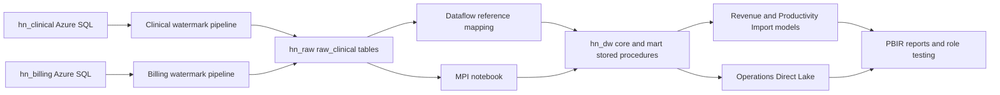

# HealthNet synthetic estate ? build in progress

This branch is independent of Round25 and contains no DIA engine changes. No DIA scan, investigation, ticket, reader grant or scanner grant is admitted by this build.

## Owner decision and native provisioning, 2026-10-30

Owner approved both free-offer SQL databases and Fabric items within the itemized bounds in owner-actions.md: ?Approve all three within these bounds?. Both databases were absent before creation. The owner Azure CLI created hn_clinical and hn_billing on sql-orderops-9696025 in Central US. Separate fresh readback confirms each GP_S_Gen5 GeneralPurpose serverless, max2/min0.5 vCore,32GiB,60minute inactivity pause,useFreeLimit=true,freeLimitExhaustionBehavior=AutoPause. Native receipts remain in .local/hospital-estate, with resource metadata only.

Existing Fabric owner provisioned HealthNet Analytics (d237966c-b0b6-4123-bc89-e69643f4bf1f) on the existing active Central US FTL4 capacity ec15bc07-8e88-436e-8dbe-485b9a7f4533. Capacity binding was read back. Lakehouse hn_raw=0d5289e1-3133-4ddb-87bc-77e287b54935; Warehouse hn_dw=ef705467-9870-481c-b977-aad877b83c30. Warehouse creation succeeded; an initial client URL assembly defect caused a404 while polling, not a failed create. The exact operation was recovered via the documented operations endpoint and its succeeded result, without duplicate creation. No capacity setting or role assignment changed.

## Cost

SQL: $0 while eligible for the monthly free allowance; mandatory pause at the free limit prevents overage. Serverless connections are short-lived. A four-hour load schedule can exhaust the free CPU allowance because the60minute inactivity tail is billable compute; availability after that point is intentionally not promised. No switch to paid overage is authorized. Fabric: existing capacity unchanged; target <=20GB retained OneLake data, illustrative hot storage20?$0.023=$0.46/month, owner storage bound$1/month. Regional billed storage and refresh capacity consumption still require measurement. No additional capacity purchased. [SQL free offer](https://learn.microsoft.com/en-us/azure/azure-sql/database/free-tier?view=azuresql), [serverless pause](https://learn.microsoft.com/en-us/azure/azure-sql/database/serverless-tier-overview?view=azuresql), [OneLake storage](https://learn.microsoft.com/en-us/fabric/onelake/onelake-storage-tiers).

## Sources and reset

One schema contract in fixtures/hospital/schema.py describes20clinical and12billing tables, columns, nullability and intra-database foreign keys. Every source table has created_at,updated_at,updated_by,is_deleted. Signed integer cents avoid monetary rounding drift. Business-number links across the two databases intentionally have no FK. Clinical patient,encounter,order_line and billing charge,claim use native system versioning; order_line has30day retention. Synthetic business audit dates do not backdate native system-versioned history. Native before/after updates must be made only during later authorized tests; this build does not pretend a historical retention gap exists at creation.

Rebuild fresh local artifacts: `python -m fixtures.hospital --output <new-directory>`. Seed20261030; defaults60,000patients/250,000encounters/1,500,000orderlines. Existing outputs are refused, never deleted. Local sources are SQLite; source AzureDDL and per-table canonicalSHA256 accompany them. The same seed must reproduce every table hash. Local artifacts do not establish native deployment or visual reconciliation.

## Flow

The diagram is the intended architecture, not a completion claim. Native pipelines, Dataflow, notebook, populated warehouse, semantic models, reports and RLS validation are pending at this checkpoint. See baseline document for the distinction between local and native checks.

## Generator realism

See hospital-estate-realism.md for every distribution, benchmark, assumption and code-set license. Built-in messiness and actual counts are emitted by verify.py, including late/cross-month charges, zero/bundles, cancelled/voided/reentered orders, payment reversal/refund/move pairs, duplicate/mergedMRNs, provider assignments, claim corrections/resubmissions, observation-to-IP, transfers, soft deletes, null providers, payer remaps and cross-system missing business numbers. No real persons or licensed CPT/CARC/NUBC content is used.

## Build checkpoint, 2026-10-30

The full seed-20261030 sources are complete locally: 60,000 patients,
250,000 encounters, 1,500,000 order lines and 2,774,006 results. All 13
independent relational, chronology and monetary checks passed. The current
A/R snapshot equals charges plus adjustments minus payments exactly:
6,506,074,701 cents. Native source loading is in progress; local success is
not a claim of native reconciliation.

Measured built-in messiness: 1,200 duplicate MRNs; 600 explicit merges;
36 provider transfers; 383,820 late charges, of which 36,422 cross months;
59,994 cancelled and 27,701 voided orders; 4,980 reentries; 2,208 payment
reversals; 1,171 refunds; 813 mispost moves; 30,140 corrected claims and
9,971 resubmissions; 2,064 observation-to-inpatient conversions;
2,437 interhospital transfers; 202 soft-deleted encounters; 3,600 null
attendings; 4,942 zero charges; 100 billing-only accounts and 497
clinical-only encounters. These are synthetic mechanisms, not planted
DIA expectations.

The generator's arrival weighting is applied in UTC; ED timestamps are
then converted to America/Chicago with their actual offsets. It is not a
claim of calibrated local-hour arrival distributions. Full-source
admission fraction from ED is 11.47%, completed inpatient ALOS 5.05 days,
LWBS 2.21%, initial adjudicated denials 12.07%, final 2.86%. Benchmark
populations differ; these measurements are not national estimates.

Generated native artifacts now include both watermark pipelines, the
reference Dataflow Gen2, explicit MPI notebook, warehouse procedures,
three semantic models and three PBIR reports (30 visual containers,
two filtered bookmarks, one drillthrough page). Offline field-binding
validation and all 14 generator tests passed. Native publishing, refresh,
rendering, baseline and owner role-testing remain pending. The MPI
notebook is published but has not run. No DIA identity was granted access.

The planned source cadence is daily (02:00 / 02:30 UTC), not every four
hours. A 60-minute idle tail on six daily wakes can exceed the free SQL
compute allowance; one daily wake leaves more room. Mandatory pause at
the free limit remains enabled. Schedules stay disabled until native
manual verification and allowance review; no paid overage fallback.

The first source bulk load failed before a table commit because the TDS
client interpreted untyped column names as NVARCHAR. Explicit BIGINT,
FLOAT, NVARCHAR and DATETIME2 metadata fixes the class of error; its
regression passes. The resumed load commits and journals bounded batches.

Owner connection creation is not yet verified. The Clinical form showed
OAuth login complete, but Create returned: "Unable to create connection
for the following reason: It looks like the refresh token expired.
Please go to this dataset's settings page, and reenter the credentials
for the data source." The owner was asked to reauthenticate and save;
no password, refresh token or administrator cache was copied into code.
Warehouse SQL bootstrap attempts separately returned DNS error 11001 and
"Couldn't complete the operation due to a system update. Close out this
connection, sign in again, and retry the operation." Neither establishes
a permission problem. Each failed receipt is retained locally; no native
warehouse completion is claimed.

## Source table and column reference

All tables also carry the audit group `created_at, updated_at, updated_by, is_deleted`. Native DDL specifies types, nullability, primary/foreign keys, update-watermark indexes and foreign-key indexes. Cross-database encounter numbers are intentionally business links, not cross-database foreign keys.

| Source | Table | Business columns |
|---|---|---|
| hn_clinical | facility | id, name, region, licensed_beds |
| hn_clinical | department | id, facility_id, name, service_line |
| hn_clinical | unit | id, department_id, name |
| hn_clinical | bed | id, unit_id, facility_id, name |
| hn_clinical | provider | id, synthetic_npi, name, specialty, fte, provider_type, current_department_id |
| hn_clinical | provider_assignment | id, provider_id, department_id, valid_from, valid_to |
| hn_clinical | payer_plan | id, plan_code, payer_group |
| hn_clinical | patient | id, person_key, mrn, given_name, family_name, birth_date, sex, fictional_address |
| hn_clinical | patient_alias | id, patient_id, alias_patient_id, alias_type |
| hn_clinical | patient_merge | id, survivor_id, duplicate_id, merged_at |
| hn_clinical | encounter | id, encounter_number, patient_id, facility_id, department_id, attending_provider_id, payer_plan_id, encounter_type, initial_status, status, arrival_utc, admit_utc, discharge_utc, service_day, readmission_of, transfer_from |
| hn_clinical | adt_event | id, encounter_id, event_type, event_utc, from_facility_id, to_facility_id |
| hn_clinical | bed_assignment | id, encounter_id, bed_id, start_utc, end_utc |
| hn_clinical | ed_visit_detail | id, encounter_id, triage_level, arrival_local, utc_offset_minutes, door_to_provider_minutes, ed_los_minutes, lwbs, admitted, transferred |
| hn_clinical | diagnosis | id, encounter_id, code_system, code, description, sequence |
| hn_clinical | procedure | id, encounter_id, provider_id, code_system, code, description, performed_utc, workload_units |
| hn_clinical | order_header | id, encounter_id, provider_id, order_type, ordered_utc |
| hn_clinical | order_line | id, order_header_id, line_number, item_code, priority, status, ordered_utc, completed_utc, replaces_order_line_id |
| hn_clinical | result | id, order_line_id, component, status, observed_value, unit, reference_low, reference_high, resulted_utc |
| hn_clinical | medication_admin | id, order_line_id, encounter_id, drug_code, dose, unit, administered_utc, status |
| hn_billing | payer | id, name, payer_group |
| hn_billing | payer_plan | id, plan_code, current_payer_id |
| hn_billing | payer_plan_history | id, payer_plan_id, payer_id, valid_from, valid_to |
| hn_billing | account | id, account_number, encounter_number, facility_id, patient_mrn, payer_plan_id, opened_at |
| hn_billing | charge | id, account_id, service_date, post_date, revenue_centre_code, procedure_code, units, amount_cents, correction_of, correction_reason |
| hn_billing | claim | id, account_id, claim_group, version, submission_type, is_original, is_final, bill_type, ms_drg, submitted_at, status, billed_cents |
| hn_billing | claim_line | id, claim_id, charge_id, amount_cents |
| hn_billing | remittance | id, claim_id, received_at |
| hn_billing | remittance_line | id, remittance_id, claim_line_id, paid_cents, adjusted_cents, denied_cents, denial_code, denial_category, remark_code |
| hn_billing | payment | id, account_id, claim_id, payment_date, amount_cents, payment_type, reverses_payment_id, moved_to_account_id |
| hn_billing | adjustment | id, account_id, adjustment_date, amount_cents, adjustment_type |
| hn_billing | ar_snapshot_daily | id, snapshot_date, facility_id, payer_id, aging_bucket, balance_cents |

## Warehouse and model reference

Each projected table has an owner-run `sp_<table>` rebuild procedure; `sp_run_all` invokes them in declared dependency order. `load_watermark` records `(source_system, table_name, watermark_utc, watermark_id)`. `load_audit` records run, pipeline, table, trigger/start time, end, status and native copy rows-read/rows-written. Counts are taken from activity output, never from a recount. Templates are not a claim of native execution.

`core_facility`, `core_department`, `core_provider`, `core_provider_department_history`, `core_payer`, `core_payer_plan_history`, `stg_patient`, `mart_encounter`, `mart_ed_visit`, `mart_order`, `mart_charge`, `mart_claim`, `mart_remittance`, `mart_payment`, `mart_adjustment`, `mart_ar_aging`, `mart_procedure`, `mart_census_daily`, `mart_provider_productivity_daily`.

| Model | Mode | Tables |
|---|---|---|
| HealthNet Operations | Direct Lake | core_facility, core_department, core_date, mart_encounter, mart_ed_visit, mart_order, mart_census_daily, security_mapping |
| HealthNet Revenue | Import | core_facility, core_department, core_payer, core_date, mart_charge, mart_claim, mart_remittance, mart_payment, mart_adjustment, mart_ar_aging, security_mapping |
| HealthNet Productivity | Import | core_facility, core_department, core_provider, core_date, mart_encounter, mart_order, mart_procedure, mart_provider_productivity_daily, security_mapping |

## Measure definitions

These are generated model definitions; native processing and reconciliation are still pending. Currency is converted from integer cents only in DAX.

| Measure | DAX | Meaning |
|---|---|---|
| Gross Charges | `SUM(mart_charge[amount_cents])/100` | Signed gross charges by service date, including corrections; not collections. |
| Net Revenue | `[Gross Charges]+SUM(mart_adjustment[amount_cents])/100` | Service-date gross charges plus signed adjustments in their adjustment-date window; not cash. Payer remapping uses each event date. |
| Collections | `SUM(mart_payment[amount_cents])/100` | Signed posted insurance and patient cash, including reversals, moves and refunds. |
| Gross Charges by Post Date | `CALCULATE([Gross Charges],USERELATIONSHIP(mart_charge[post_date],core_date[calendar_date]))` | Same signed charges, grouped by post date rather than service date. |
| Denied Dollars | `CALCULATE(SUM(mart_remittance[denied_cents]),mart_remittance[is_original]=1)/100` | Original adjudicated denied dollars by synthetic denial category. |
| Initial Denial Rate (count) | `DIVIDE(CALCULATE(COUNTROWS(mart_claim),mart_claim[is_original]=1,mart_claim[status]="DENIED"),CALCULATE(COUNTROWS(mart_claim),mart_claim[is_original]=1,mart_claim[status]<>"SUBMITTED"))` | Original adjudicated claim count; pending claims excluded. |
| Denial Rate ($) | `DIVIDE(CALCULATE(SUM(mart_remittance[denied_cents]),mart_remittance[is_original]=1),CALCULATE(SUMX(mart_remittance,mart_remittance[paid_cents]+mart_remittance[adjusted_cents]+mart_remittance[denied_cents]),mart_remittance[is_original]=1))` | Denied dollars over original adjudicated remittance dollars; differs from count rate. |
| Final Denial Rate | `DIVIDE(CALCULATE(COUNTROWS(mart_claim),mart_claim[is_final]=1,mart_claim[status]="DENIED"),CALCULATE(COUNTROWS(mart_claim),mart_claim[is_final]=1,mart_claim[status]<>"SUBMITTED"))` | Latest version of each adjudicated claim group; differs from original claim rate. |
| ALOS | `AVERAGEX(FILTER(mart_encounter,NOT ISBLANK(mart_encounter[admit_utc])&&NOT ISBLANK(mart_encounter[discharge_utc])),DIVIDE(DATEDIFF(mart_encounter[admit_utc],mart_encounter[discharge_utc],SECOND),86400))` | Completed inpatient admission-to-discharge days, excludes active admissions. |
| Midnight Census | `SUM(mart_census_daily[midnight_census])` | Occupied beds at America/Chicago local midnight. Across several days this is occupied bed-days, not distinct patients. |
| Bed Occupancy % | `DIVIDE(SUM(mart_census_daily[midnight_census]),SUM(mart_census_daily[licensed_beds]))` | Occupied bed-days divided by licensed available bed-days; capacity-weighted, not an average of facility percentages. |
| ED Door-to-Provider (median) | `MEDIAN(mart_ed_visit[door_to_provider_minutes])` | Minutes from ED arrival to provider; blank for LWBS, median over nonblank observations. |
| LWBS % | `DIVIDE(SUM(mart_ed_visit[lwbs]),COUNTROWS(mart_ed_visit))` | Left without being seen among all retained ED visits. |
| ED Visits | `COUNTROWS(mart_ed_visit)` | Retained ED visits, not all encounter types. |
| 30-day Readmission % | `DIVIDE(COUNTROWS(FILTER(mart_encounter,NOT ISBLANK(mart_encounter[readmission_of]))),COUNTROWS(FILTER(mart_encounter,NOT ISBLANK(mart_encounter[admit_utc]))))` | Explicit same-person unplanned synthetic readmission links within30days; not risk adjusted. |
| Visits | `COUNTROWS(mart_encounter)` | Non-soft-deleted encounters of non-soft-deleted source patients; a transfer can contribute two visits. |
| Unique Patients | `DISTINCTCOUNT(mart_encounter[mpi_patient_id])` | Distinct MPI survivors among retained encounters, differs from distinct MRNs. |
| Order Count | `COUNTROWS(mart_order)` | Retained order lines including cancelled and voided statuses; select status to narrow. |
| Completed Orders | `CALCULATE(COUNTROWS(mart_order),mart_order[status]="RESULTED")` | Final resulted status only; excludes withdrawn void/reentry predecessors. |
| RVU-style Workload per FTE | `DIVIDE(SUM(mart_provider_productivity_daily[workload_units]),SUMX(VALUES(core_provider[id]),CALCULATE(MAX(core_provider[fte]))))` | Fictional workload units divided by unique provider FTE, never represented as licensed RVUs. |
| Procedures | `COUNTROWS(mart_procedure)` | Retained procedure rows, not encounters or order lines. |
| Writeoffs | `-CALCULATE(SUM(mart_adjustment[amount_cents]),mart_adjustment[adjustment_type]="BAD_DEBT")/100` | Positive display of signed bad-debt adjustments; excludes contractual and charity. |
| A/R Balance | `CALCULATE(SUM(mart_ar_aging[balance_cents]),mart_ar_aging[snapshot_date]=MAX(mart_ar_aging[snapshot_date]))/100` | Posted account balance at the latest snapshot in the selected context; never sums multiple snapshots. |

## Dynamic role and OLS configuration

The existing Fabric owner `admin@skynwhy.com` has four security-mapping rows for owner role-testing: Executive (all), HospitalManager (facility 1), DepartmentHead (department 2), Doctor (provider 1). These are mapping data, not four role grants. Membership and owner role-test results remain unverified. No DIA or scanner mapping or permission is created.

Every role requires `USERPRINCIPALNAME()` to match its mapping row. Facility, department and provider restrictions propagate through one-direction dimension-to-fact relationships. DepartmentHead cannot see facility-only aggregates that lack department grain (census and A/R); they have explicit FALSE filters. Doctor is denied Operations and Revenue; in Productivity it is restricted to its provider, with cost and margin columns hidden by OLS. Owner role-testing must establish these native effects before any security success claim.

### Native owner connection and warehouse correction, 2026-10-30

After owner reauthentication, native Fabric listing confirms HealthNet
Clinical Owner 91f9fa32-8875-454b-b28c-120bc399a1ac and HealthNet Billing
Owner 01437114-ac49-4204-828e-f9bde09f2465, each on the exact approved
server/database, OAuth2, Encrypted, Organizational, SSO None,
skipTestConnection false. Gateway sharing and code-first credential access
are false. Original failed save is preserved. No investigator or scanner
permission was changed.

The recurring DNS error was localized to python-tds trying to resolve a
native TDS redirect containing `host\instance` as one hostname. Separating
the instance fixed that error (regression passes), but the driver next
received Server closed connection. The existing Windows .NET
System.Data.SqlClient client then completed bootstrap using the same
isolated owner profile with certificate checks enabled: served identity
admin@skynwhy.com, zero prior tables, 394 calendar rows, four owner
role-testing mapping rows. Control/reference tables are now native;
warehouse marts are not populated yet. Receipts bootstrap01-08 remain
local, including failures. No ODBC installation or weakened TLS was needed.

Dated count clarification: the earlier `late_charges=383820` metric counts
all postings after service, including ordinary 1-3 day billing delay. It
is not the 5% special-delay cohort. There are 25,016 charge rows posted at
least four days after service, measured separately. Source rows and the
original verification receipt are unchanged.

Warehouse owner bootstrap is now verified (2026-10-30): 394 calendar rows,
four security-mapping rows and native owner identity admin@skynwhy.com.
The next connection uses that existing Fabric owner, not the Azure SQL
owner's Gmail sign-in. No new identity, role or database grant is needed.
The generated nightly pipeline runs native reference Dataflow and MPI
notebook before its warehouse stored procedures; it remains unbound and
unrun until the Dataflow ID and destination credentials are verified.

Dated model definition correction, 2026-10-30: Midnight Census now uses the
latest calendar date in the selected context, matching its point-in-time
label and the independent local midnight check; it no longer sums bed-days
across dates. Bed Occupancy remains a capacity-weighted ratio over the
selected period. Reports also expose admissions, discharges, readmissions,
resulted-order turnaround and payer mix explicitly (33 total containers,
including text/slicers). Field binding passes; native rendering is pending.

## Native integration checkpoint, 2026-10-31 UTC

Both source databases are fully populated, including the native temporal
configuration (clinical patient/encounter/order_line and billing
charge/claim). Full native source canonical reconciliation is running;
counts alone are not a hash match. Independent local marts and their
baseline are complete. All 23 hospital generator/artifact tests pass.

Native published items: df_reference_mapping
5be967da-aa22-44ed-ae6d-f564039d7e62; pl_clinical
 db94b75c-7898-4cc8-94d3-33356b834948; pl_billing
006744b8-2e01-4a39-b46b-6066330dfe1b; pl_nightly_run_all
d91893e9-aed1-4585-b56b-6c3c488bed8a. Source and reference-model
credentials remain owner-only. HealthNet Warehouse Owner
5397d91d-3257-4db9-9397-433c3e6bf445 is an OAuth Warehouse connector;
its generic credential context is paired with the exact native workspace,
warehouse and endpoint in each activity's connectionSettings.

The first owner connectivity probe failed with workspaceId missing;
legacy linkedService plus a top-level credential reference was not enough.
The corrected connectionSettings form completed the Warehouse lookup,
Azure source lookup and Warehouse Script SELECT in separate read-only
probes. Original failed and successful run receipts are retained. Reference
copies now use the native OverwriteSchema enum; incremental copies use
Upsert with keyColumns=[id], following the documented Lakehouse contract.
[Lakehouse copy properties](https://learn.microsoft.com/en-us/fabric/data-factory/connector-lakehouse-copy-activity).

Clinical ingestion d391c856-f9fe-4dbe-a808-27ec10e52916 and billing
ingestion 79629a3a-d2a6-426b-801e-9e2611a03872 are in progress. The
clinical facility activity has natively succeeded with rowsRead=3 and
rowsCopied=3; its following audit/watermark Script also succeeded. This
is an initial functioning hop, not a completed estate reconciliation.
Dataflow/notebook transformations, marts, model processing, rendering and
RLS checks are still pending. No schedules have been enabled.

### Owner-build checkpoint, 2026-10-30 (America/Chicago)

All 32 native source tables now match the generated row counts and canonical SHA-256 hashes, including 2,774,006 results; `native-source-reconciliation.json` records `all_matched: true`. This is source reconciliation only, not downstream verification.

The owner saved HealthNet Model SQL Owner (`8a49d254-e4e3-4729-9365-12d3ebfe5042`) for the exact hn_dw SQL endpoint/database, OAuth2, encrypted, Organizational privacy, SSO off, gateway sharing off. Credentials remain in Fabric. No identity or permission was added.

Original clinical run d391c856-f9fe-4dbe-a808-27ec10e52916 and billing run 79629a3a-d2a6-426b-801e-9e2611a03872 FAILED with LakehouseTableMissingKeyColumns at encounter/charge respectively. The native editor proves `sink.upsertSettings.keys = ["id"]`; the earlier top-level `keyColumns` property was accepted by the definition API but ignored at runtime. The diagnostic editor edits were not published (Save validation refused other missing keys). Both complete definitions were corrected through REST updateDefinition, read back, and their before/after definitions retained separately in the local owner journal. Original failed runs and audit rows are unchanged. Replacement runs: clinical 72e005dc-f00a-4aef-a400-2dfc10ffa598; billing 4b3a5889-b360-42cf-9a0e-27984c2835ed. These are admitted, not yet verified successful. All 23 focused generator tests pass with the corrected property contract.

MPI notebook first run 942020ac-25cc-44fd-87ba-94afa1bbf61b is admitted. Dataflow first execute 4f55674a-6b27-4c54-9f1e-5f04f903158e failed with JobInstanceStatusFailed / "Job instance failed without detail error"; diagnosis is pending. No native Dataflow/MPI success or end-to-end baseline is claimed. No schedules, capacity changes or DIA access were enabled.

### Native integration correction, 2026-10-30 (America/Chicago)

MPI notebook run 942020ac-25cc-44fd-87ba-94afa1bbf61b Completed. A separate owner SQL read confirmed 15 raw/prepared tables visible (including stg_patient); the earlier empty table API listing is retained as a time-specific observation, not proof of missing files.

The clinical replacement failed at commit_unit with a native snapshot-isolation update conflict on load_watermark while billing was concurrently committing. The audit transaction previously deleted/reinserted watermark rows; the generic correction appends watermark history (the existing MAX reader already supports this), uses IF NOT EXISTS for the run/table audit row, SET XACT_ABORT ON, and three bounded Script retries. Failed runs are retained; future restarts are serialised. Twenty-five focused tests pass, including the commit contract and journaled definition-update readback.

Dataflow's exact native refresh error is ModelBuilderEvaluationChallengedResult: "Credentials are required to connect to the Lakehouse source. (Source at Lakehouse.)" Existing shared Lakehouse admin was not changed. A separate HealthNet Lakehouse Owner admin connection (71f7f92d-3d2c-4513-ab66-b394131a0161; cluster 7e46fcb7-355d-42e5-a7d8-66fab5959fd2) was created through the source-connection form with the existing signed-in admin@skynwhy.com session. Organizational privacy, gateway sharing unchecked; no new identity or grant. Native preview now returns the 14 payer-history rows. queryMetadata was updated through REST to the verified composite connection ID; replacement refresh 26243713-ba4a-4bd8-8e1c-b9a1abae38f4 is in progress, not yet a success.

Three semantic models were created through REST and bound/read back to fixed OAuth SQL connection 8a49d254-e4e3-4729-9365-12d3ebfe5042: Revenue df6e3f67-deb6-4cb8-b15a-353176931679; Productivity 0ef2b1a3-c6b7-4623-b962-39fe12c84d06; Operations 85e662ed-c4e6-41fb-9e43-be0c5a6aeeae. Native reports were created against these model IDs: Operations da276dc2-b133-40a9-8da4-fde9f9980545; Revenue d47bb5e2-608f-4294-85cd-8fb0ade7a5d4; Doctor Productivity 48b38369-2aac-427c-9c4b-a184fb464808. Creation is not refresh/rendering/RLS verification; those checks remain pending.

### Dataflow success and native SQL dialect correction, 2026-10-30 (America/Chicago)

The replacement Dataflow run 26243713-ba4a-4bd8-8e1c-b9a1abae38f4 Completed; native output row counts are 14 and 396. Billing pipeline replacement 4b3a5889-b360-42cf-9a0e-27984c2835ed Completed. Clinical fed7cee4-a8e6-4fe7-be61-644c9de360d9 failed because Fabric Warehouse rejects SET XACT_ABORT ("XACT_ABORT is not supported for SET."). This owner-build defect is preserved, not treated as a planted estate defect. The unsupported SET was removed through REST, with readback. Clinical replacement 3c74a789-49f4-44af-8344-e8cd079d2f92 was admitted only after the preceding run ended; it retains explicit transactions, append-only watermarks, idempotent run/table audit insertion and bounded retries.

The baseline query helper compiles each authored visual and categorical bookmark into DAX, with deterministic group ordering, a 100-row display window and the total result cardinality. Large patient-detail baselines must be labelled as a window, never as the complete visible population. Static text has no data query. Native model queries and browser rendering remain separate checks.

Native role checks will use the existing owner with XMLA Roles/EffectiveUserName, which is the model engine's role-testing path, without assigning any new account a role. [Microsoft's XMLA impersonation documentation](https://learn.microsoft.com/en-us/power-bi/enterprise/service-premium-connect-tools#impersonation) explains owner testing of lower permissions. No role test is claimed before its native result exists.
