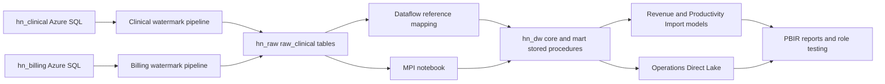

# HealthNet synthetic estate ? build in progress

This branch is independent of Round25 and contains no DIA engine changes. No DIA scan, investigation, ticket, reader grant or scanner grant is admitted by this build.

## Owner decision and native provisioning, 2026-10-30

Owner approved both free-offer SQL databases and Fabric items within the itemized bounds in owner-actions.md: ?Approve all three within these bounds?. Both databases were absent before creation. The owner Azure CLI created hn_clinical and hn_billing on sql-orderops-9696025 in Central US. Separate fresh readback confirms each GP_S_Gen5 GeneralPurpose serverless, max2/min0.5 vCore,32GiB,60minute inactivity pause,useFreeLimit=true,freeLimitExhaustionBehavior=AutoPause. Native receipts remain in .local/hospital-estate, with resource metadata only.

Existing Fabric owner provisioned HealthNet Analytics (d237966c-b0b6-4123-bc89-e69643f4bf1f) on the existing active Central US FTL4 capacity ec15bc07-8e88-436e-8dbe-485b9a7f4533. Capacity binding was read back. Lakehouse hn_raw=0d5289e1-3133-4ddb-87bc-77e287b54935; Warehouse hn_dw=ef705467-9870-481c-b977-aad877b83c30. Warehouse creation succeeded; an initial client URL assembly defect caused a404 while polling, not a failed create. The exact operation was recovered via the documented operations endpoint and its succeeded result, without duplicate creation. No capacity setting or role assignment changed.

## Cost

SQL: $0 while eligible for the monthly free allowance; mandatory pause at the free limit prevents overage. Serverless connections are short-lived. A four-hour load schedule can exhaust the free CPU allowance because the60minute inactivity tail is billable compute; availability after that point is intentionally not promised. No switch to paid overage is authorized. Fabric: existing capacity unchanged; target <=20GB retained OneLake data, illustrative hot storage20?$0.023=$0.46/month, owner storage bound$1/month. Regional billed storage and refresh capacity consumption still require measurement. No additional capacity purchased. [SQL free offer](https://learn.microsoft.com/en-us/azure/azure-sql/database/free-tier?view=azuresql), [serverless pause](https://learn.microsoft.com/en-us/azure/azure-sql/database/serverless-tier-overview?view=azuresql), [OneLake storage](https://learn.microsoft.com/en-us/fabric/onelake/onelake-storage-tiers).

## Sources and reset

One schema contract in fixtures/hospital/schema.py describes20clinical and12billing tables, columns, nullability and intra-database foreign keys. Every source table has created_at,updated_at,updated_by,is_deleted. Signed integer cents avoid monetary rounding drift. Business-number links across the two databases intentionally have no FK. Clinical patient,encounter,order_line and billing charge,claim use native system versioning; order_line has30day retention. Synthetic business audit dates do not backdate native system-versioned history. Native before/after updates must be made only during later authorized tests; this build does not pretend a historical retention gap exists at creation.

Rebuild fresh local artifacts: `python -m fixtures.hospital --output <new-directory>`. Seed20261030; defaults60,000patients/250,000encounters/1,500,000orderlines. Existing outputs are refused, never deleted. Local sources are SQLite; source AzureDDL and per-table canonicalSHA256 accompany them. The same seed must reproduce every table hash. Local artifacts do not establish native deployment or visual reconciliation.

## Flow

The diagram is the intended architecture, not a completion claim. Native pipelines, Dataflow, notebook, populated warehouse, semantic models, reports and RLS validation are pending at this checkpoint. See baseline document for the distinction between local and native checks.

## Generator realism

See hospital-estate-realism.md for every distribution, benchmark, assumption and code-set license. Built-in messiness and actual counts are emitted by verify.py, including late/cross-month charges, zero/bundles, cancelled/voided/reentered orders, payment reversal/refund/move pairs, duplicate/mergedMRNs, provider assignments, claim corrections/resubmissions, observation-to-IP, transfers, soft deletes, null providers, payer remaps and cross-system missing business numbers. No real persons or licensed CPT/CARC/NUBC content is used.

## Build checkpoint, 2026-10-30

The full seed-20261030 sources are complete locally: 60,000 patients,
250,000 encounters, 1,500,000 order lines and 2,774,006 results. All 13
independent relational, chronology and monetary checks passed. The current
A/R snapshot equals charges plus adjustments minus payments exactly:
6,506,074,701 cents. Native source loading is in progress; local success is
not a claim of native reconciliation.

Measured built-in messiness: 1,200 duplicate MRNs; 600 explicit merges;
36 provider transfers; 383,820 late charges, of which 36,422 cross months;
59,994 cancelled and 27,701 voided orders; 4,980 reentries; 2,208 payment
reversals; 1,171 refunds; 813 mispost moves; 30,140 corrected claims and
9,971 resubmissions; 2,064 observation-to-inpatient conversions;
2,437 interhospital transfers; 202 soft-deleted encounters; 3,600 null
attendings; 4,942 zero charges; 100 billing-only accounts and 497
clinical-only encounters. These are synthetic mechanisms, not planted
DIA expectations.

The generator's arrival weighting is applied in UTC; ED timestamps are
then converted to America/Chicago with their actual offsets. It is not a
claim of calibrated local-hour arrival distributions. Full-source
admission fraction from ED is 11.47%, completed inpatient ALOS 5.05 days,
LWBS 2.21%, initial adjudicated denials 12.07%, final 2.86%. Benchmark
populations differ; these measurements are not national estimates.

Generated native artifacts now include both watermark pipelines, the
reference Dataflow Gen2, explicit MPI notebook, warehouse procedures,
three semantic models and three PBIR reports (30 visual containers,
two filtered bookmarks, one drillthrough page). Offline field-binding
validation and all 14 generator tests passed. Native publishing, refresh,
rendering, baseline and owner role-testing remain pending. The MPI
notebook is published but has not run. No DIA identity was granted access.

The planned source cadence is daily (02:00 / 02:30 UTC), not every four
hours. A 60-minute idle tail on six daily wakes can exceed the free SQL
compute allowance; one daily wake leaves more room. Mandatory pause at
the free limit remains enabled. Schedules stay disabled until native
manual verification and allowance review; no paid overage fallback.

The first source bulk load failed before a table commit because the TDS
client interpreted untyped column names as NVARCHAR. Explicit BIGINT,
FLOAT, NVARCHAR and DATETIME2 metadata fixes the class of error; its
regression passes. The resumed load commits and journals bounded batches.

Owner connection creation is not yet verified. The Clinical form showed
OAuth login complete, but Create returned: "Unable to create connection
for the following reason: It looks like the refresh token expired.
Please go to this dataset's settings page, and reenter the credentials
for the data source." The owner was asked to reauthenticate and save;
no password, refresh token or administrator cache was copied into code.
Warehouse SQL bootstrap attempts separately returned DNS error 11001 and
"Couldn't complete the operation due to a system update. Close out this
connection, sign in again, and retry the operation." Neither establishes
a permission problem. Each failed receipt is retained locally; no native
warehouse completion is claimed.
