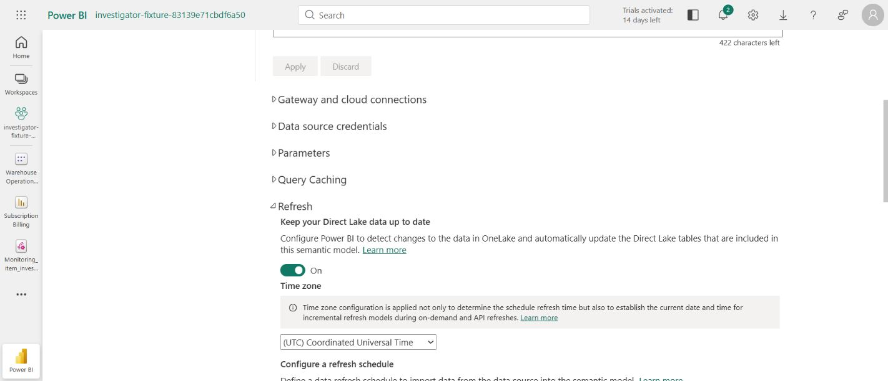

Round 22 is complete. PR #429 merged as `567a95b66aca136fdc9488bfe2664857d3a85f9a`; `v0.22` tags that validated merge. This final report is published in a documentation-only commit on main after the tag.

The once-only independent held-out result is **5/20, with 0 harmful findings**. The pass line was missed: fewer than 16 correct answers and six classes with no correct answer. Zero harmful findings does not establish general investigation capability.

Completed dev scores: pass 1 **1/40**, pass 2 **6/40**, pass 4 **11/40**, pass 5 **13/40**, pass 6 **14/40**. Pass 3 remains partial and unscored. Pass 6 is final; no pass 7 or regrading. Completed scored dev passes had 0 harmful findings. The original per-class zero-score groups for passes 4?6 remain below and in the linked records.

| Expected class | Final dev 6 | Once-only held-out |
|---|---:|---:|
| As designed | 4/15 | 2/2 |
| Not found | 2/5 | 0/5 |
| Failed job | 6/6 | 1/2 |
| Waiting on job | 2/2 | 2/2 |
| Access difference | 0/2 | 0/2 |
| Different question | 0/2 | 0/2 |
| Latency | 0/4 | 0/1 |
| Source changed history | 0/2 | 0/2 |
| Refresh stale | 0/2 | 0/2 |

Failed-job and waiting classes have no zero-score cases in dev passes 4?6. Legacy closed with 34/40 outcomes: 10 HELD, 24 CLARIFYING and 6 not run. It remains ungraded; no comparative accuracy score is claimed.

Held-out startup-plus-worker time: median **55.45 seconds**, p90 **109.30 seconds**. This excludes final timing-sidecar publication and client retrieval, and includes seven intake questions/holds. No cross-layer numerical comparison completed in this held-out cohort, so these times do not establish the full-investigation target. Dev 6's five completed native comparisons had a median of 154.83 seconds, missing the 120-second target.

Held-out engine usage cost **$0.874234**, or **$0.0437117 per ticket** (36 calls). Independent grading cost **$0.192325**, or **$0.00961625 per ticket** (20 calls). These are conservative usage-priced model charges, not compute invoices. All 20 original outcomes and independent grades are retained in [the scored record](runs/round-twenty-two-scored-heldout.json); [the breakdown](runs/round-twenty-two-heldout-breakdown.json) contains individual reasons, timing and cost.

The scoring pin stays `3c5935a` / image `802d8508?`. The release package uses source `8ae02f1` / image `48a53a46?`, with only a daily-smoke calendar correction and three tests changed afterward. The original whole-package freeze is superseded for release runtime; no held-out score is assigned to the newer package. Investigator reasoning modules, scored outputs, expectations and tapes were not changed.

The first final smoke was INCOMPLETE despite a passing family A answer: after day 25, the access table always added an untestable next-month owner reminder. The smoke now reads the exact existing account from the authoritative platform ledger, retaining the original table. It creates nothing and cannot hide another failed or untestable probe. The first compatibility build failed an unchanged step-order test; the conditional-step fix passed 47 focused tests. Both failures remain recorded. Three subsequent consecutive smokes passed every check and Azure reported Succeeded, retaining the original 7,661/8,765 witness. No smoke expectation changed.

Validation: the frozen pre-held-out suite passed 5,325 tests with 49 skips. Final pre-merge and post-merge suites each passed **5,328 tests, 49 skips, zero failures/errors**. All **21 merge-commit CI checks succeeded**, with **2 intentional skips**. A GitHub HTTP 500 interrupted one local status poll; the same GET was retried without restarting a workflow. Round-specific byte-exact replay was skipped under the owner steer; existing replay-specific CI/regression tests still ran. See [release validation](runs/round-twenty-two-release-validation.json) and [the merge/tag record](runs/round-twenty-two-release.json).

All temporary injections are reverted: original application current-row and business-schema hashes match; four original pipeline definition hashes match; owned temporary schedules, access-test objects and stale/latency rows are removed; the fixed connection is restored; automatic updates are ON and the model's own refresh completed. Native reads returned model **7,661** and Bronze **360 rows / 7,661 units**. Temporal history intentionally remains ON; native job, refresh and audit histories are retained. The extra complete Bronze business-row hash is **UNESTABLISHED** after two Azure starts failed before any capture header. Count/sum is not represented as that hash proof. Exact reverts and exceptions are in [the restoration receipt](runs/round-twenty-two-restoration.json) and [injections.md](../tests/tickets/injections.md).

Budget at **2026-10-26 23:45:37 UTC**: **5,439/6,000 physical requests** ? investigation **3,607/3,905**, scans **1,762/2,000**, restoration **70/95 used** (25 remaining). Total, investigation and scan usage exceed 80%; warnings remain active. Monthly investigator model spend is **$10.202640/$40**; enrichment last verified **$7.148004/$25**. Round 22 added **$8.384842** investigator model spend and **$1.977522** enrichment above the recorded opening. Counters, historical UNCERTAIN charges, caps and roles were preserved; no new identity, permission or secret was created during closure.

Open engine work: target/container disambiguation, faithfully executable filtered paths, use of access/history/freshness evidence, and the blocked flag on one credited waiting answer. The two capture-less Bronze hash checks remain an explicit verification limit. None is relabelled as success. Original failures and operator recoveries remain in [blockers and lessons](blockers-and-lessons.md).

## Preserved historical progress log

Earlier claims below are dated intermediate observations; final results and corrections above supersede them without altering original run evidence.

Latest checkpoint — owner2026-10-24 / executionUTC2026-10-25: speed steer adopted. Engine batch e515d9d pushed; draft image builds now use focused tests. Dev4 is still frozen on d11367e/image9c684502: static26 and latency4 returned, with the temporary latency rows/schedule restored and full363-row/schema hashes matched. Retained8 then waiting2 continue serially; no completed pass4 score yet. An original pre-intake ConnectionTimeout capture is retained separately from its replacement. Legacy baseline closed34/40 (10HELD,24CLARIFYING, zero technical findings, ungraded); remaining6NOT_RUN. Latest authority03:37:53UTC physical3429/6000, modelUSD7.034793/40, reserve95untouched. Persistent stale/history/access fixtures remain for dependent scoring; heldout remains uninspected. All earlier checkpoints below are historical.

## Reliability fixes

2026-10-22 progress (UTC observations extend into October 23; amended prompt
re-read, completed work retained):

- **1a green:** snapshot deadline 180 -> 300 seconds; assertions unchanged.
  Full frozen129556e suite: 5,019 PASS / 48 skip, zero errors/failures,
  683.747s including the snapshot module inside the parallel run.
- **1b pending:** before run job-dia-worker-2zmlavm finished02:58:52-03:45:03UTC,
  2,771s, Azure Succeeded but actual smoke FAIL/NO_COMPARABLE_PATH. Complete
  output preserved at.local/round-twenty-two/smoke-before.log. Old tape diagnosis proves quantity ALLOW
  occurred after the child deadline. Remote evidence publication is deferred
  outside that handshake, without changing the expectation or read-only checks.
  Corrected smoke1/job-dia-worker-fet4jr7 is running. Three consecutive green
  runs have not been earned.
- **1c cause established (owner duration test):** original execution remained
  active through immutable publication at69s; the live probe at70s. Both
  exceeded the60s enclosing limit; the live child exited0 without a deadline
  expiry. Record the outer job limit as cause, correcting the earlier unknown
  conclusion without altering evidence. Changed only the enclosing limit to
  180s, read back with unchanged image/resources/schedule/identity. Confirmation
  job-dia-collectors-ue92850 Succeeded in56s (03:44:57-03:45:53UTC), child exit0
  without deadline expiry; seal3bd5ece6. Its manual allowance stays4; FETCH exhaustion
  remains a probe limitation. The scheduled six-hour collector is the real
  fresh-load test.
- **1d green:** exact two scanner refresh GETs recorded in decisions.md;
  investigator remains Viewer. Existing scanner guard/transport suite28PASS.
- **1d-2 implemented, live confirmation pending:** closed source failure classes,
  metered transient retry, availability facts and blocked output;12 focused
  tests PASS, including failed-load cause/time checks and comparison blocked
  without inventing a numerical cause. **1d-3 implemented, cloud timings pending:**
  normal/test recording, batched audit, staged replies, current-context-only
  catalog materialization;5 focused audit/catalog tests PASS. The new input
  archive is15,330,618bytes versus116MB previously; originals unchanged, stored
  MD5 verified. These added items precede section2. New ledger investigator is
  the default engine; legacy remains baseline only. The old-config smoke
  monitor was stopped before further admissions; its active cloud execution
  was not interrupted.

Opening shared usage: 749/6,000 requests, investigator$1.817798/$40,
enrichment$5.170482/$25; restoration95 untouched. Corrected smoke1 is in flight.
Section 2 has not started; the reliability gate remains red.

Production reliability source1ac73a4 passed5,026 tests /48skip, zero failures or
errors in688.403s. Later6c6b963 changes only a synthetic child's import path
and documentation; all8container shards plus image publication PASS. Deployed
image604867fc to the same three jobs, preserving schedules/resources/identity.
Fresh ec59eef suite passed5,027/48skip, zero errors/failures in662.537s before
the amended availability/mode additions. It is not their full-suite result.

## Agent-state patterns

All nine patterns are implemented; source `d66432a` full suite is green (5,131 tests,48 skipped,zero failures/errors). Image39978613480 all8shards and publicationPASS; live smoke and cloud harness validation are in progress.

| Pattern | Commit | Regression test | Status |
|---|---|---|---|
| Code-owned case | `2ca2462` | `test_round_trip_preserves_every_code_owned_field` | Focused PASS |
| Recitation | `e34efd4` | `test_matching_recitation_is_silent_mismatch_is_logged_and_cannot_advance` | Focused PASS |
| Just-in-time evidence | `a01d935` | `test_explicit_raw_fetch_is_cleared_after_the_next_model_call` | Focused PASS |
| Visible errors and blocked repeats | `6db6a65` | `test_same_failed_signature_is_blocked_different_arguments_are_allowed` | Focused PASS |
| Code-owned tool scope | `4280a7e` | `test_forbidden_tool_never_dispatches_and_code_advance_changes_tools` | Focused PASS |
| Durable checkpoint | `78da28c` | `test_killed_investigation_resumes_completed_steps_and_identical_case_without_re_reads` | Focused PASS |
| Stable prefix | `d002908` | `test_two_tickets_have_identical_prefix_and_scope_references_expand_before_validation` | Focused PASS; live cache measurement pending |
| Optional clean reader | `f1e9f75` | `test_enabled_reader_returns_summary_to_real_parent_loop_without_raw_growth` | Focused PASS; default OFF |
| End-to-end harness | `79a21a1` | `test_fixture_ticket_submits_polls_and_receives_real_engine_case_log` | Focused PASS; cloud harness pending |

Resume2026-10-23: clean working tree and pushed head `ac042944` confirmed. Its predecessor full suite found one platform-literal ratchet failure in the new harness, retained verbatim. Source `d66432a` moves the provider port under adapters without changing the ratchet or its allowance;10 focused tests PASS. Full suite completed5,131 tests/48skip,zero failures/errors in1000.119s. Image workflow39978613480 completed all8shards and publication successfully; digest8db2ba2d. No new live/model request admitted before the full-suite result.

## Scored ticket set

See the closing results and linked immutable records in this summary. No additional unrecorded result is claimed.

## Validation

See the closing results and linked immutable records in this summary. No additional unrecorded result is claimed.

## Budget

See the closing results and linked immutable records in this summary. No additional unrecorded result is claimed.

## Open items

Inherited unresolved application-source access checks and native replay drift
remain. Daily smoke's expected TRANSFORMATION_LOGIC has not yet been earned
three consecutive times; corrected smoke1 is in flight. Audit enclosing
runtime correction confirmed Azure Succeeded. No fresh load fact is claimed
from the four-request manual probe: UNCHANGED_MARKER and retained unavailable
coverage (SQL_READ_FAILED:LockNotAvailable:None). Scheduled six-hour collection
remains the real test.

## Deferred

See the closing results and linked immutable records in this summary. No additional unrecorded result is claimed.

### Status refresh owner steer ? 2026-10-23 (owner instruction 2026-10-22)
Status questions now attempt `refresh_facts` on stale/missing admitted-path facts before answering. A missing collector is a failed route, classified QUERY_ERROR, rather than permission to return a stale status. Refresh permission/network failures retain the source-availability class, observation time and owner; hard guardrail/budget failures still propagate. Fresh ledger facts require no top-up. On-demand force now reaches the underlying incremental collector, so an unchanged run marker cannot prevent renewing stale observations. The cloud status spec will bind only the fixture pipeline's existing metadata route (no audit SQL, no off-path subjects); existing scheduled/manual audit limits remain unchanged.
The first NORMAL status execution job-dia-worker-rgjhvlg took 38s Azure start-to-end, with 1.793382s admission/path and 1.839225s investigation (engine loop 0.360824s, inclusive). This missed the <30s total target. Startup was not separately recorded in that old sidecar; remaining time is not falsely labelled startup. New observational sidecars include UTC worker timing start for comparison with Azure's execution start, separately from investigation and publication. No old capture or receipt changed.
Full corrected-image 5c25dc6 suite: 5,050 PASS / 48 skipped, no errors, 683.078s. New-engine smoke job-dia-worker-hu1s138 finished Azure Succeeded in 288s but smoke FAIL (family-A check); not a passing smoke. Its sealed capture remains unchanged. Three consecutive new-engine smoke passes are not yet earned.

### NORMAL smoke witness transport ? 2026-10-23
The sealed first amended-engine smoke reached the measured 8,765/7,661 boundary and a checked native TRANSFORMATION_LOGIC witness. It then failed at the provider-input admission guard: fetching that witness duplicated 58,675 characters of native assessment/observations into the next model request (configured bound48,000). The bound was not raised. The model view now supplies the checked mechanism, classification, support and evidence IDs, excluding duplicated native observations and rendered outputs. Original full witness/tape bytes remain unchanged in evidence storage and consumer validation still uses them. Retained real witness projects to3,587 characters. Regression proves the input witness is untouched and the model receives the proof classification/references. This is a reliability transport repair; the section2 pattern programme has not been declared complete.

Status refresh negative-history regression (2026-10-23): a successfully refreshed, complete empty run history is not a failed query or an outage. It remains an honest no-record answer; the refresh failure classifier is used only when collection fails or yields no usable status/history observation. Existing fresh complete negative history needs no repeated top-up.

### Status steer live result ? owner 2026-10-23
`job-dia-worker-hm27jiu` (source7d9653f, tested imagee93a69cb) Succeeded at05:12:27UTC. Stale facts were refreshed only for pipeline3bf74ae1? through two metadata GETs; zero model calls and zero quantity probes. The fresh latest run37b546ca? is SUCCEEDED, so the explicit status question is answered without inventing a failed-job incident or numeric cause. Seal9b0a87c0? and full timing receipt: docs/runs/round-twenty-two-status-refresh.json.
Startup to capture clock27.485616s; investigation10.773940s; capture publication4.102764s (inclusive, overlaps); Azure total52s. Remaining setup/publication/shutdown13.740444s is not relabelled startup. Owner now accepts <60s total for job-based status runs this round: PASS. Original <30s result remains recorded, superseded only as the acceptance target. No startup optimization is planned this round. Full-investigation target remains <120s.
The fba799a full suite passed5,054 tests /48 skipped in807.412s. Final-source full validation and the three-smoke sequence continue. Operator budget reporting stalled before admitting a smoke; its read-only process was stopped with no reservation issued. A direct read-only control-plane snapshot completed and reports880/6000 physical (INV466/SCAN414/REST0), modelUSD2.128512/40, no new reserved model rows, reserve95 intact. Runtime admission, locking and lease guards were not changed.

### Section1 checkpoint and soft-gate continuation ? 2026-10-23
Full sourceaa409a7: **5,056 PASS /48 skipped**, zero failures/errors,734.374s. Tested source7d9653f imagee93a69cb has all8 offline shards and publicationPASS. All three jobs read back unchanged schedules/identity/resources; worker3600s, graph1800s, collectors180s (the separately recorded60?180 decision).
Corrected-image smoke sequence: h3xzssv PASS280s (05:18:14?05:22:54UTC), wfdgnq0 PASS277s (05:24:18?05:28:55), ibc6h0s FAIL290s (05:29:52?05:34:42). First two retain as-designed verdict and native TRANSFORMATION_LOGIC at8765/7661; third fails provider-input admission, not an estate or model-provider authorization failure. Every original seal remains unchanged. **Three consecutive greens are not earned.**
Under the amended prompt's explicit three-fix soft gate, continue section2 with the gate OPEN: deferred handshake publication, NORMAL batching/path materialization, and compact design-witness transport were three distinct fixes; the request still grows beyond48000 characters after extra definitions and repeated evidence fetches. The exact failed get_evidence signature, seals, results, readbacks and budget are in docs/runs/round-twenty-two-section-one.json. No threshold or expectation is loosened. The code-owned state/JIT/repeat/prefix work directly addresses this remaining blocker; rerun after that work.
Budget at05:35:41UTC: **1003/6000 physical** (INV466/SCAN537/REST0), reserve95 untouched, model**USD2.967361/40**;68 settled and2historical uncertain reservations, no new open reservations. Enrichment remainsUSD5.170482/25. No new identity, grant or secret. Status52s passes the owner's amended<60s job target; standalone full-investigation<120s remains to be established (smoke investigator phase106.36s is not standalone end-to-end timing).

Pattern2a implemented: versioned code-owned case, validated model notes, retained snapshots and final outcome. Module2tests, investigator39tests, image-staging5tests PASS offline. No new live/model call. Pattern2f resume remains pending.

### First three state patterns ? 2026-10-23
2a code-owned case and validated annotations;2b model recitation compared to code state (including definition judgment calls);2c summary-only ordinary context with one-call raw retrieval and hash-bound paging for large evidence. Each pattern has a separate commit, tests and architecture entry. Focused case3, investigator42, ports14 and cloud assembly12 tests PASS; image-staging5PASS. No live/model call during these edits. The section1 smoke blocker stays OPEN until final-pattern validation; no request bound or acceptance expectation changed.

### State patterns2d?2f ? 2026-10-23
Failed exact calls are blocked from retained case errors; tool sets follow code-owned phases; shared checkpoints resume completed logical steps with original evidence/probes and ledger-backed read accounting. The real child-process kill/restart test passes, with identical preserved case state and no completed native rereads. Changed binding/hash and concurrent revision tests refuse reuse. Case3, playbook1, checkpoint3, investigator43, native ports15, source-availability17 and cloud assembly12 focused tests PASS offline. No live read or model call during pattern work. Interrupted-operation charges remain on the shared ledger; no scope, secret or allowance changed. Final full/image/smoke validation remains pending after all nine patterns.

### Final three state patterns ? 2026-10-23
2g stable per-phase system/tool prefixes keep IDs/context/key in dynamic payload and validate expanded references against the original consumer;2h optional clean-context heavy reader stays OFF unless trusted step configuration enables it, returns only an untrusted reading note with checked references;2i submit/poll/outcome harness uses the real dia CLI and verifies the seal/result. All have separate commits and tests/architecture entries. Focused ports17, reader3, harness4, checkpoint3, core43 and staging5 PASS offline. No new live or model call during these edits; last observed physical1003/6000, modelUSD2.967361/40, reserve95 intact. Full/image/harness/smoke validation and a new-prefix live cache measurement remain pending2j. The retained pre-pattern cache baseline is65.36% cached input tokens, explicitly not a new-pattern measurement. Three-consecutive smoke gate remains OPEN after PASS/PASS/FAIL and the documented soft-gate continuation.

### Section2 gate earned, 2026-10-23
Source `d66432a`: full5,131 tests/48skip,zero failures/errors; image workflow39978613480 all8shards and publicationPASS. Tested digest8db2ba2d deployed to all3 jobs with unchanged schedules/resources/identities/timeouts. Smoke `job-dia-worker-wnj7nkc` PASS all6checks, Azure Succeeded,15:49:43?15:55:52UTC(369s), native TRANSFORMATION_LOGIC atSilver7661/Gold8765; new engine verdict as designed. Original seals retained; NORMAL mode has no byte-exact replay claim. This earns2j's daily-smoke gate; it does not earn three consecutive greens.
Actual new-prefix provider usage:7552/60610 cached input tokens(12.46%),4/8call hits,0unknown; lower than retained pre-pattern65.36% baseline, not presented as a speed improvement. Investigation phase180.91s; standalone job timing remains to be measured through the user harness. Root model_calls8 versus embedded cost.model_calls7 is a retained accounting-display discrepancy to inspect during development; shared ledger settled all8.
Shared budget after:1176/6000physical(INV466/SCAN710/REST0), modelUSD3.424084/40,80settled/2historicaluncertain, reserve95untouched. EnrichmentUSD5.170482/25 unchanged. Public receipt: docs/runs/round-twenty-two-patterns-validation.json. ContinueSection3; no scored ticket or injection yet.

Standalone user harness validation2026-10-23: `job-dia-worker-wvq9ret` AzureSucceeded16:00:15?16:07:44UTC(449s), client472.20s, seal a4cd6ef7?. Exact ticket echo and capture seal PASS. Engine result not found/TICKET_BUDGET_REACHED after18modelcalls/1native read; only the visual was read. A proposed refresh-stale verdict was correctly rejected for missing divergent equivalent-context reads; subsequent evidence fetches did not measure pending boundaries. No established cause or successful fixture investigation is claimed. Full retained outputs: docs/runs/round-twenty-two-user-harness.json. This is unscored validation, not a Section3 dev or held-out record. The <120s standalone target is missed. No injection has been applied.

Owner frontier steer2026-10-23 implemented before any scored dev run: v2 case retains successful exact results, duplicates return the saved result plus evidence-ID feedback and a blocked event. Rejected verdicts and3exploratory model steps without quantity/proof progress transfer control to the first unmeasured boundary, then unchecked hypotheses. The deterministic continuation retains a one-tool phase record, preserves exact scope/key, and reuses the unchanged native/evidence validators. No-progress phases advance; exhaustion reports not found and furthest measured point.133focused tests PASS, including5new frontier regressions. Image build and one replacement A harness validation pending; original18-call result preserved. Section3 set is not yet sealed or run;12old-ticket fairness tasks prepared, no injection applied.

Section3 preparation: scoring contract committed separately before set admission;40dev and20+held-out, strict verdict/layer/cause scoring and independent grading, with per-batch physical allowance40per ticket under the unchanged6000monthly ceiling. Twelve original Round17 fairness inputs are prepared using visible labels only; provider calls not yet admitted. Original question files are unchanged. Routine platform input archive1a3066c2? uploaded without overwrite and stored-MD5 verified; secret references only. No controlled injection applied and no scored set sealed yet.

Owner frontier confirmation2026-10-23: exactly one A rerun, `job-dia-worker-6u1avrg`, source8611703/tested image9ecb3fec, AzureSucceeded16:30:31?16:35:09UTC(278s), client318.87s. **As designed**, native **TRANSFORMATION_LOGIC**, evidence-proven code frontier. **4provider calls versus18before**; original not-found capture remains unchanged. Seal f744a1b9?. The correct finding is earned; the<120s full-investigation target is still missed. This is unscored validation, not a dev or held-out ticket. Full outputs, measured values, case errors/blocks and exact budget delta: docs/runs/round-twenty-two-frontier-family-a.json. Continue Section3; no scored run or injection yet.

Frontier source8611703 full regression:5,143 tests/48skip,zero failures/errors,1116.59s; all4local shards exit0. Independent fairness batch completed12/12 schema-valid judgments atUSD0.041762 enrichment,0estate reads. Several judgments confuse the ability to investigate with answering from labels alone; originals retained and independent criteria clarification pending. No exclusions adopted or scored tickets admitted.

Section3 control checkpoint2026-10-23: three real failed-job controls acrossfixture/billing now collector-confirmed with matchingrunIDs/error2011. Original pipeline definitions restored and servedhashes match; no originaldata activity ran or history was removed. Readercollectors used2fixture+4billing SCAN requests, within unchangedmanual4perjob. Two local reporting stalls preserved; secondstack establishes SharedUsage.mirror wait before nextAPI dispatch, notFabric latency. One originalphysical reservation stays conservativelycharged RESERVED. Bothfairnessreviews preserved; all12oldquestions remaininset dueunsupported/inconsistentexclusions, notrewritten. EnrichmentUSD5.259538/25 before ticketwriter. Otherverdictcontrols/setseal/scoringstillpending. Receipt docs/runs/round-twenty-two-failure-controls.json.

Independent writer firstbatch completed3tasks/6unchanged ticketdrafts,USD0.006052enrichment. Fullset is not sealed/scored; drafts in tests/tickets/independent-drafts-real-failures.json. As-of17:37UTC physical1262/6000(INV538/SCAN724/REST0),investigatorUSD4.080700/40;95reserveuntouched. EnrichmentafterwriterUSD5.265590/25. PlatformactualobservationUSD0.646485at17:35UTC,CostManagement429twice thenbackoffsuccess; oldlaunchconfigsnotretimestamped. No next-class fault is applied.

Raw operational entry wiring, offline before scoreddev: exact graph-name admission preserves original ticket and source span; optional run_selector is inside the FACTrequest and selects a unique retained historical run at stated precision, never latest fallback. Native timestamps retain seventh-ninth digits; missing/finer/ambiguous references refuse or ask one combined essentials question. Both outputs state selection precision. Raw calculation admission explicitly remains unsupported; no default visual or expected target fills it. Selector8/intake7/cloudassembly13/factproducer23/core45/frontier5 targeted tests passed. Newfull/image pending. Independently derived fixture7661->8765 andbilling700->950 arithmetic committed separately from current value verification. Sample196-byte DueDate definition hash8b542b83 verified through approvedCAS restoration. Six more baseline wordings are being independently authored. README legacy encoding prevented UTF8 decoding; checkpoint appended asASCII without transcoding existing bytes.

Owner frontier completion, 2026-10-23: one A validation reached as designed/native TRANSFORMATION_LOGIC with 4 provider calls versus 18; original preserved. Six frontier tests plus core/cloud tests pass (64 total), including short evidence-only feedback on successful raw retrieval repeats. Pre-score source9c770d3 full5168/48skip/zero failures and all8 image shards pass; final feedback change separately focused-tested. Full evidence and limits: docs/round-twenty-two-frontier-confirmation.md. No scored dev run yet. Prior freeze invalid.

Section3 continuation2026-10-23: six independently written baseline drafts preserved unchanged as DEV only; three provider messages,USD0.006628,zero estate reads. Full set/held-out sealing and scoring still pending. Owner approved and verified one existing SQL laptop /32 firewall replacement, no other scope change; original40613/40615 controls preserved.

Source before-state completed2026-10-23T19:09:44UTC: existing owner control read360syntheticrows,7,661units, complete row/schema preimage retained. One INV physical request,zero diagnostic/model calls or source mutations. Firewall replacement readback verified. A later40613 occurred during serverless resumption; after Azure reported Online, the bounded retry completed in8.47s. Two earlier report-preflight connection failures dispatched no SQL and remain preserved. Source receipt docs/runs/round-twenty-two-source-baseline.json; pre-writer40/20allocation in docs/round-twenty-two-set-construction.md. Not a scored result.

Source readiness update2026-10-23: corrected guard/source-resume image19bd668 passes all8hostedshards/publication. Sourceprofile03 retried40613 at30s, passed both permission guards, then exposedSQL529 for generic timestamp-to-text profile conversion. Complete schema-driven binary-hex correction57focusedtestsPASS; no data or permission changes. NativeSourceProfile has not yet produced values. All3Wait-only pilot jobs completed and originaldefinitions restored/hashconfirmed after localPGIdleInTransactionSessionTimeout; publisherobservations only, no readerRUNNING facts earned. All failures retained; source-profile-attempts and wait-pilot-recovery receipts in docs/runs. Set sealing/scoring stillpending.

2026-10-23 source profile04 Succeeded (20:55:34-20:58:35UTC), sealed24ffa60f3705aadab6e65313b02ce1b7a94bcc719642a31e2eef8b78a319211f. Schema-typed compiler54e8a91 query executed through tested cloud transport19bd668: row_count360, eight checksums, read_only_verified=true, VALUE_QUERY self-report identifies expected investigator531419ef@aeb4d0a9, ordersops and Microsoft SQL Azure. Startup access audit and probe are counted separately in the capture (all physical results recorded); zero model calls or source mutations. This confirms typed-query transport, not end-to-end collector wiring, semantic equality or the units sum. Prior failed captures remain unchanged. Receipt docs/runs/round-twenty-two-source-profile-success.json.

2026-10-23 waitingpilot03: budget PGconnection failed while reading all historical state_usage during job-start admission, before publisher dispatch. Three definition control requests completed; one Wait-only definition was changed, no job submitted. Fresh recovery listed native jobs, found none active, restored original definition/hash (four requests). No readerRUNNING facts earned; original error retained. Budget query now selects only the existing UTC monthly/adoption interval and joins allocations for those rows, under the same serialized transaction. No status/owner/estate filtering, no deletion, no cap, timeout or retry change.32monthly/controltestsPASS, including identical decisions for full-history versus period reads and pending/uncertain/unclassified cross-estate charges. This reduces transfer while locked; the connection failure root cause remains unproven.

2026-10-23 PostgreSQL follow-up: last24h server-log listing returns zero available files (no logging setting enabled or changed). The monthly query narrowing did not eliminate the next laptop connection failure, so it is not a confirmed disconnect fix. Add bounded30/45second retries only to untaped build-control shared reservation admission, keeping owner/key/request constant and reconciling a lost commit acknowledgement before HTTP dispatch. No settlement of another owner, no timeout/cap/role changes; exact tapes and legacy paths retain their prior behavior.35budget/controltestsPASS, including commit-ack loss -> one charge/one dispatch, bounded exhaustion, and auth/query/policy refusal without retry. Initial new test exposed psycopg idle-timeout inheriting Error rather than OperationalError; classification corrected and all35pass. Independent collector/runtime/runner suite69PASS after correcting one test command that named a nonexistent module. Root cause remains open.

2026-10-23 owner PostgreSQL steer implemented: central connector enforces keepalives1/idle30s/interval10s/count3, connect timeout15s. Shared transactions get fresh connections and close before external work; test verifies closure before the next operation. Safe document reads/list/account snapshots reconnect once; untaped control reservations reconnect once using the same owner/key/request. General writes are not automatically replayed; authentication/permission/query/budget errors are not transport retries. Connect acquisition has one retry and is marked to avoid a second nested operation retry. Each failed SQL/commit/cursor request records client-observed idle-before-request, failed-request duration and connection age, without query text/arguments. No claim that this client interval proves server idle. Historical failures had no idle interval; do not invent one.70tests total:56PASS/14opt-in skips. Fresh live read-only ledger snapshot succeeded with zero connection failures, using the corrected laptop connector:1453/6000(INV675/SCAN778/REST0),modelUSD4.080700/40; emergency95untouched. No tier, network, role or budget changed.

2026-10-23 fixture waiting case observed by actual investigator collector at21:23:13.832107Z: job605f92df-b2e4-4851-8263-51d7ade0ad1e RUNNING, twoSCANreads within manual4, zero model calls. Azure reader executionSucceeded21:22:45-21:23:28, sealed capture retained. Original pipeline definition restored/hashconfirmed after nativeCompleted21:30:14.2933333. One waiting case now backed by reader facts; billing waiting cases remain pending. Prior metadata/configuration failures retained. No data activity executed and no source row changed. Receipt docs/runs/round-twenty-two-waiting-fixture-observed.json.

2026-10-23 waiting controls completed: native investigator collected fixtureRUNNING(twoSCAN) and both billingRUNNING(fourSCAN), each within its unchanged manual4allowance. Allthree originaldefinitions restored/hashconfirmed; source data unchanged and controlled history retained. Billing publisher stage8ordinaryINV and recovery8ordinaryINV completed with zero reservation retries/read connection failures using new laptop keepalives/short-lived transactions. These are three actual scenario cases, not scored engine verdicts. Waiting wording is still pending independent batch completion, with DEV2/heldout2 allocation fixed before inspection; restage the same named controlled case for future live scoring rather than calling a historical completed job running. Full80d0940 regression5192total/5144passed/48skipped, zero failures/errors,742.40seconds. Later structured failure-journal/cursor-context/keyed-settlement follow-up48focusedtestsPASS; do not claim the prior full result covers that follow-up.

2026-10-23 independent waiting writer completed three provider messages/four unchanged drafts (DEV2,heldout2 mechanically partitioned without displaying text). AddedUSD0.003998; enrichmentUSD5.276216/25. No engine/expectation/ledger inputs to writer,zero estate reads or investigator calls. These are drafts, not the final sealed60set. Every future scored waiting case must re-stage its named real control and readerRUNNING facts; completed historic runs never substitute. Hashes/seal in docs/runs/round-twenty-two-independent-waiting.json.

2026-10-23 source-history control preparation: existing fixture builder now emits a bounded, parameterized SELECT for only the planned new synthetic IDs, including native rowversion converted to bigint. Managed SQL reader still enforces existing table-only scope, read-only guards and query-bound attestation; no arbitrary ticket SQL or new permission.44fixture/control/apply/gatewaytestsPASS. No source row has been changed. Before any mutation: durable insert/restoration recipe, sealed original preimage, current budget/disk, and a reader observation route must be ready.

2026-10-23 source-history control failures retained: pilot01 changed no source data (twoSQLreads: native40613 while resuming, then SQL156 from an unquoted identity alias in the operator prewarm query). Pilot02 inserted three authored back-dated rows, then the investigator query failed at stagequery, SQL1033/42000;76unsealedpartialrecords preserved. Source controller restored only its three native-version-pinned rows and confirmed the complete original rows hash0a78462d4e4dfd7bf66aeda89cd4d4757f2149fb00d61a14a597922216049a0b,360rows/7661units. ZeroPGdrops/retries during insert/restoration, no permission/identity change, zero model calls. Reader observations of the new rows are not earned yet; owner mutation receipts are not promoted to investigator evidence.

Offline diagnosis: managed_sql_worker adds query-bound attestation by wrapping the SELECT as a derived table. The fixture observer had ORDER BY without TOP. Microsoft [documents the derived-table ordering restriction](https://learn.microsoft.com/en-us/sql/t-sql/queries/select-order-by-clause-transact-sql). Fix the fixture compiler with TOP(n+1), retaining one overflow row and exact-ID/row-count validation; do not remove attestation, change permissions or silently truncate to n.58fixture/managed-worker/gatewaytestsPASS. This is a control-query compiler defect, not evidence of a source outage. The native error code/stage plus constructed statement support the diagnosis; the worker intentionally does not retain arbitrary driver message text. SQL database-wide rowversion advanced during the authored inserts and cannot be rewound; original rows and their native versions are restored.

2026-10-23 source control03 succeeded: existing read-only investigator returned allthree authored back-dated rows, matching IDs/business fields/native versions, with query-bound self-report on ordersops and read_only_verified=true. Same tested cloud transport19bd668, fixture query compileraf9eb5f TOP overflow fix. Source controller restored only its three rows, then verified the complete original row hash and schema hash:360rows/7661units. FourownerSQLcontrolrequests, noPGdrop/retry, zero model calls or permission changes. Native source observations are NOT a completed HISTORY_CHECK witness or scored verdict; no arbitrary old row values are inferred from source_modified_at. Separate native audit/version proof is required for the full history producer. DB-wide rowversion advances are explicitly not rewound. Receipt docs/runs/round-twenty-two-source-history-native-observation.json.

2026-10-23 PostgreSQL completion check: frozen4d7cac3 full suite5196total/5148passed/48skipped, zero failures/errors,696.99s; later TOP fixture repair is covered separately by58focusedtests and hosted CI. Current82470b9 connection/transaction/control-meter checks21PASS; an initial command named a nonexistent test module and was corrected, not hidden. Fresh owner read-only ledger snapshot at2026-10-23T22:32:23.765773+00:00 succeeded with zero connection failures:1516/6000(INV731/SCAN785/REST0), modelUSD4.080700/40, reserve95untouched. No estate/model calls, new permissions or firewall changes. All waiting/source controls restored. Earlier PostgreSQL disconnect cause remains OPEN; successful keepalive operations do not establish causality. No scored dev or sealed60set yet.

2026-10-23 owner source-history steer: choose(b), native system-versioned temporal history on the existing practice source. Existing primary key, no triggers, proposed history absent; native rollback-only DDL probe accepted hidden periods with existing rowversion and restored complete original row/schema hashes. Two physical owner-control requests, zeroPGdrops/retries, zero model calls. Earlier read-only metadata attempt returned SQL40613; Azure then reported Online and the separate retained retry succeeded. No firewall, role or tier changed. Temporal history is not yet enabled by this checkpoint.47fixture/gatewaytestsPASS; initial positive temporal SELECT test exposed the closed AST allowlist, now narrowly admits SYSTEM_TIME ALL only on an independently allowlisted physical table. Red-team tests still refuse writes, external/other objects, AS OF and unknown version forms. Prior freeze invalidated.

2026-10-23 owner option(b) applied: native system-versioning ON for existing practice source1938105945, owned history510624862/app.stock_movements_round22_history. Two hidden generated period columns; complete original360rows/7661units and original eight-column schema hashes match. Native initialhistory0rows; current+history reservedallocation204800bytes (total, not incremental/monthly billed cost). Three publisherSQLcontrols, zeroPGdrops/retries, no grants, identities, tier or free-limit changes. Feature intentionally remains enabled through dependent scored dev/held-out runs; no scored history ticket admitted yet. Native empty-history digest returnedNULL, so cleanup compiler now normalizes emptyJSON to[] before hashing; keep original receipt unchanged. Temporal observation converts datetime2(7) periods to native text, preserving seventh fractional digit. Focused fixture/gateway42testsPASS after removing duplicate imported fixture-test discovery; prior47/48 counts included those duplicate executions. Prior freeze invalid.

2026-10-23 native temporal retention confirmed: cloud investigator executionjob-dia-worker-moadola Succeeded22:50:11-22:52:00UTC, imagec21e46a/source24a56e4. It read three native historical rows900201/900202/900203 after current rows had already been restored and complete original row/schema hashes checked. Native periods22:49:27.1219695-22:49:30.3563391UTC survive as seven-digit text; quantities7/11/13 and native versions44001/44002/44003 match insert receipts. Sealbc27fd8cc92bfb09cb2ba2df393bab205814f448a44bcc2e9aeec6bd6db90f0b,78records. Fourpublishercontrols, zeroPGdrops/retries, zero model calls or grants. Temporal feature/history remains enabled for dependent scores. A bounded fixture point-in-time comparison query is now prepared/tested: matched-row count plus nullableSUM keeps absence separate from0, timestamps bound exactly through7digits.43focusedfixture/gatewaytestsPASS. No scored ticket or HISTORY_CHECK verdict yet; prior freeze invalid.

2026-10-23 native historical comparison succeeded as investigator: executionph830vc22:57:57-22:59:21UTC. For movements900201/900202/900203, at22:49:20UTC matchedrows0/SUMBLANK; at22:49:28UTC matchedrows1/SUM7,11,13. Native retained coverage begins22:43:47.9434148UTC, before both requested times. Current source remains restored and native history remains enabled. This proves before/after data remains queryable after restoration; no scored engine verdict claimed. Existing engine gaps retained for dev: ProcessChecks only installs DESIGN_CHECK; validate_history wraps before_quantity as VALUE, so BLANK-before insertion cannot be silently treated as0. No expectation or contract changed to hide that gap. Receipt docs/runs/round-twenty-two-temporal-before-after.json.

2026-10-23 independent source-history writer completed three provider messages/four unchanged drafts (DEV2,heldout2 mechanically partitioned without displaying wording), after native temporal before/after proof. AddedUSD0.006193; enrichmentUSD5.282409/25. No engine, expectation or ledger internals given to writer; zero estate reads or investigator calls. Drafts are not the final sealed60set. Native history remains enabled and must be checked at scored admission; no removed injection supplies runtime evidence. Input007 was never submitted and remains preserved as superseded by the owner evidence-lifetime steer. Hashes/seal in docs/runs/round-twenty-two-independent-history.json.

2026-10-23 frozenfcce806 full suite5203total/5155passed/48skipped, zero failures/errors,1122.15seconds. Allfourshards exited0. This covers native temporal enablement/empty-history normalization; later point-in-time fixture compiler is separately43focusedPASS and final cleanup NULL checks7focusedPASS. Cleanup now refuses missing object IDs or NULL native digests explicitly instead of relying on SQL three-valued comparisons. No history cleanup executed. Hosted24a56e4 all8shards+publicationPASS, fcce806 andb396844 hosted checksPASS; no claim of a final release gate. Native history remains enabled, current source restored, no scored60set/dev/held-out yet. Independent drafting currently32tickets:28DEV/4HELDOUT, not a sealed final set. Last ledger1557/6000(INV772/SCAN785/REST0),investigatorUSD4.080700/40,enrichmentUSD5.282409/25,reserve95untouched; diskC27.45/D13.18GiB. All recent owner PostgreSQL reads/controls had zero drops/retries; earlier idle-drop cause remains open.

2026-10-23 different-context preparation: three same-application export comparisons independently derived from committed seed literals before native reads. Warehouse1/2:2948/2084; product7/8:1104/1258; September14/15:923/772. Complete derivation script, row counts and seed hash in docs/round-twenty-two-context-controls.md; no report-total or pipeline-defect claim. Bounded fixture-only grouped compiler uses two bound context values, nativeSUM and a keyed result; no estate mutation, new permission or engine route. Two testsPASS. Initial test wrongly looked for digit2 anywhere in a statement containing a dated table name; corrected to assert the WHERE AST has parameters and no literals. Native values and scored verdicts not earned yet. Prior freeze invalid.

2026-10-23 native source-context controls allSucceeded: warehouse2948/2084, product1104/1258, event-day923/772 match independent committed-seed arithmetic. Three keyed within-layer native group reads, zero model calls or estate mutations. They prove actual differing scopes/values, not an engine different-question verdict. Native cases/times/seals: docs/runs/round-twenty-two-context-native.json. No grouped control is backfilled as an investigation cell receipt.

2026-10-23 access-difference preparation: native billingapp metadata confirms existing dia-investigator-round19(EXTERNAL_USER) and orderops_investigator(SQL_USER,DATABASE) both have db_datareader, proposed isolated access objects absent, app schema exists. First metadata readSQL40613, separate retry33seconds later succeeded; no firewall/tier/permission changed, and no quota-exhaustion cause inferred. Existing protected SQL-reader file was checked by username only; no secret printed/copied. Plan uses app.round22_access_rows(6syntheticrows), app.round22_access_readers(3data mappings), app.round22_access_export: CURRENT_USER chooses visible data; this is not a security policy and not an actual permission difference. Same native group query, separate real sign-ins, no impersonation. Existing role scope supplies SELECT; no grant planned. Independent synthetic sums: SQLreader10/20/30, investigatorSP25/45/65. Four new fixture/closed-scope testsPASS. No objects created yet; native paired observations/scoring pending. Prior freeze invalid.

2026-10-23 owner date / 2026-10-24 UTC access controls completed: existing SQL reader observed10/20/30, existing investigator SP observed25/45/65, each through the identical business SELECT on billingapp.app.round22_access_export. Native query-bound identity/database and read-only guards passed; snapshot remains unverified. Data-backed CURRENT_USER mapping, not real security RLS or new permission. First create returnedSQL40613; separate reconciliation proved all objects absent before successful create-only control. Original failure retained; both db_datareader roles unchanged. Keep all three owned fixture objects through dependent scores; cleanup prepared, not run. Zero models; no scored ACCESS_CHECK claim. Receipt docs/runs/round-twenty-two-access-pair.json.

2026-10-23 owner date /2026-10-24UTC independent context/access writer:6provider messages,8unchanged drafts (DEV4/HELDOUT4), mechanically partitioned without exposing held-out wording. AddedUSD0.010876; enrichmentUSD5.293285/25. Zero estate reads/investigator model calls. Inputs were plain observed context/identity-export facts and labels, no engine, expectations or ledger internals. Total drafts40(DEV32/HELDOUT8), not a sealed final60set or score. Receipt docs/runs/round-twenty-two-independent-context-access.json.

2026-10-24UTC isolated-model reader control02 reached nativeDAX and was refused401/PowerBINotAuthorizedException. Azure wrapperSucceeded is not query success. Expected tokenaudience/tenant/application recorded; publisherportal maps this model to Default:SingleSign-On(EntraID), automatic updatesON. Do not infer tokenexpiry or missingBuild without further evidence. Initial01packaginghold remains separate. No modelsetting/connection/permissionchanged; no refresh-stale quantity or scoredblockedticket claimed. Receipt docs/runs/round-twenty-two-application-refresh-preparation.json.

2026-10-24UTC real original fixture copy completed: pipelineb4871498 run659ea59a-256f-4673-a661-0d6f3359d9be Completed00:31:20.8781033-00:33:57.7133333UTC (~156.84seconds). Native investigator read exactlyone matching Warehouseauditrow: Succeeded,360read/360written,OBSERVED_COPY_OUTPUT. Counts originate from the served audit writer's own CopyApplication output, not a recount; no separate activity-output download claimed.15publishercontrolrequests, no definition/source edit/modelcall. Wait-only historicals excluded as ordinary-copy evidence. Reader capture and exactrow in docs/runs/round-twenty-two-real-copy-baseline.json. No latency or scored verdict yet.

2026-10-24UTC framing-control proof refused: existingpublisher GETmodelmetadata succeeded, SDKderivedPOST metadata/models/6992510/settings bodydirectLakeAutoSync=false returned401. Reloadedpublisherportal stillshowsON, so no restorePOSTneeded and no retry/escalation. Exactrequest/response/preimage/readback: docs/runs/round-twenty-two-autosync-control-refusal.json. Twoownercontrolphysicalrequests, zero models. Causeunestablished; notcalledexpiredcredentialormissingrole. No stale-state case earned.

2026-10-24UTC native history-coverage preparation: originalmovements1/2/3 currently16/17/39units (independentcommittedseedmatch). Earliestretainednativeversion2026-10-23T22:43:47.9434148, afterrequested2026-10-20T12:00Z. Pastquantitynotqueriedas0orinvented. These are not-found questions about unretained history, distinct from proven900201-203changes; no pre-existing artifact removed. Readeridentity/readonly/querybound passed; no source mutation/modelcall/scoredverdict. Receipt docs/runs/round-twenty-two-history-coverage-gap.json.

2026-10-23 owner date / 2026-10-24 UTC: third native blocked-record control qg5qqdr failed before its DAX request with LockNotAvailable: "canceling statement due to lock timeout". Original 44 partial capture files retained unchanged, not a sealed run and not an access result. Concurrent schedule control overlapped, but the exact lock holder is not established. Code inspection found read-only budget snapshots taking the global reservation writer lock. Read snapshots now use database-enforced read-only repeatable-read transactions; reservation mutations retain READ COMMITTED, the exclusive advisory lock and both lease checks. Replay uses the same read-only contract. No broad lock-timeout/write retry, counter release, limit or permission change. This establishes an avoidable contention path, not the cause of earlier idle drops. Focused core41PASS; clean replay/full regression follows.

2026-10-23 owner date /2026-10-24UTC: independent history-coverage writer completed3messages/4unchanged drafts (DEV2/HELDOUT2), mechanically partitioned without displaying wording. AddedUSD0.005638; enrichmentUSD5.298923/25. Total44drafts(DEV34/HELDOUT10), not final sealed60set, no scored run. Requested history predates native retention; no prior quantity invented and absence never zero. Receipt docs/runs/round-twenty-two-independent-history-gap.json.

2026-10-23 owner approval applied (UTCOctober24): Application load fixture20261003 model0c89889c-6fe6-49ab-91e9-4b00a51070e6 automatic DirectLake updates ON ->OFF using existing publisher portal. OriginalON01:21:45.627, ApplyOFF01:22:14.535, reloadedOFF01:23:28.322. Chosen because original Copy Jobb4871498 targets this model's isolated Bronze source; no unrelated mainA lakehouse is claimed updated. Owner model refresh25e695e2 completed01:27:55.313, followed by real copy9869fbd1 Completed01:28:49.6055106-01:31:14.56. Native read-only investigator audit row matches run:360read/360written,OBSERVED_COPY_OUTPUT, no recount. Source/pipeline definition, identities and permissions unchanged. OFF remains intentionally through dependent scored tickets; then restoreON, trigger this model's own refresh and verify native completion. No numerical staleness or scored verdict claimed; existing SP DAX401 remains separate. Both fixture preimage and live retained-state obligations in docs/runs/round-twenty-two-stale-refresh-control.json.

2026-10-23 owner date /October24UTC: scan allocation2000/INV3905/REST95 within6000 is deployed on tested a883706/imageea772843 to daily06UTC(3600s), graph0*/6(1800s), collectors*/30(180s). Native before/after readback preserves configuration, identity and resources on all3jobs. No counters reset, no new paid resource. At01:33:54UTC total1816/6000 (INV999,SCAN817,REST0), reserve95, modelUSD4.080700/40. Native receipt docs/runs/round-twenty-two-scan-allocation.json. Freeze invalid; Section3 preparation, no scored run or release claim.

2026-10-23 owner date /October24UTC: original read-lock Windows full5224 executed:5175PASS,48skip,1ERROR,0assertion failures,1279.61s. Error retained: old safe-read test mock did not accept _read_only keyword; fixed mock now asserts that flag on both retry calls. Focused51PASS. Add connection/read-only/monthly-allocation regression modules to the published-image offline shard list; prior8shards were a selected foundation suite, not the full Windows suite. No expectation changed. Full final rerun follows.

2026-10-23 owner resume after laptop power loss (UTC24October): clean pushed efbb18b recovered. All5recent cloud worker executions plus01:30collector Succeeded; no cloud operation remained in flight at01:53UTC. Local5227test final rerun interrupted; original partial logs hashed/preserved, not a pass or failure. Affected51tests re-runPASS. No open model/enrichment reservations; interrupted publisher refresh-historyGET remains fully charged1request and is nowUNCERTAIN, originals unchanged. Five older physical reservations are unchanged and conservatively counted; historical orphan is immutable. Current1840/6000 (INV1023,SCAN817,REST0), reserve95; modelUSD4.080700/40. Owner now approves source-correct fixed identity for Appmodel and actual reversible new source rows: prior equal-data loads prove timing only, never a numeric stale discrepancy. Existing blocked-case401captures remain historical and cannot be scored against an accessible model without fresh failure staging.

2026-10-23 owner approval executed (UTC24October): isolated Appmodel0c89889c-6fe6-49ab-91e9-4b00a51070e6 changed from Automatic/SSO to source-correct ShareableCloud connectionb1a57512-f71a-41a3-b868-4ee2999c42b9, singleSignOnType=None, ServicePrincipal, Encrypted, testConnection enabled. Existing fixed fixture connection points at another database, so a source-specific connection reuses the same existing read-only investigator and active KeyVault credential; no identity, credential rotation or permission grant. Native before/after model permission listings byte-equivalent. First create refused400/AADSTS7000215 using retired Round20 secret version; original retained, continuation used completed Round21 rotation's existing active version. Cloud reader nowHTTP200,MovementUnits7661, model self-reporttenant-only warning retained, no snapshot attestation invented. Native settings/requests/hashes and read seal: docs/runs/round-twenty-two-app-fixed-binding.json. Original401 blocked cases are historical; need fresh state at scoring. Six unmetered preflight GETs conservatively reconciled as actual controls after dispatch, no admission-before-read claim. Numeric stale gap not yet earned; approved31-unit source insertion/load follows.

2026-10-23 owner date /October24UTC: three independently authored blocked-record held-out drafts preserved unchanged and uninspected. Total47drafts(DEV34/HELDOUT13), not final60seal or score. Shared restriction, not three independent outages. The new fixed connection removed that native failure; do not score blocked expectations against the accessible model. Fresh approved fault staging/native refusal is required at scored admission, followed by fixed-connection restoration. Provider3messages, addedUSD0.006539, enrichmentUSD5.305462/25. Receipt docs/runs/round-twenty-two-independent-blocked.json.

2026-10-23 owner date /24OctoberUTC: restarted clean full regression completed5227tests,5179PASS/48skip/0failure/0error,744.69seconds, onfa1a405 engine source. The affected51tests alsoPASS. Original mock error and interrupted final run remain preserved. No estate/model read in these tests; no expectation changed. Source connection/data changes are publisher-controlled fixture preparation, not scored findings.

2026-10-23 owner steer implemented (UTC24October): native stale DATA gap now exists, not timing alone. Existing SQL owner inserted only900401/900402/900403,warehouse3/product1/Oct23,units7+11+13=31; original360row hash unchanged. Independent arithmetic7661+31=7692. Real copyaada99f6 completed02:11:18.0376314-02:12:55.33. Investigator Bronze read:363rows/7692; same investigator DAX afterload:HTTP200/7661. Matching native audit row:363read/363written,OBSERVED_COPY_OUTPUT; actual copy activity timestamps02:11:45.5812408-02:12:07.6538988 differ from outer pipeline, correctly retained. No recount substituted. Source363/7692 and modelOFF intentionally retained through dependent scored tickets; guarded delete/reload/automaticON/ownrefresh+verify recipe is prepared, not executed. Browser unavailable after restart, so no fresh portal-toggle readback claimed; actual stale numerical gap verified. Tenant-only DAX and SNAPSHOT_UNVERIFIED warnings remain. Original equal-data controls stay historical; no scored investigator verdict claimed. Receipt docs/runs/round-twenty-two-stale-refresh-data-proof.json.

2026-10-23 owner date /2026-10-24UTC: independent stale-refresh writer completed3messages/4unchanged drafts (DEV2/HELDOUT2), mechanically partitioned without displaying wording. AddedUSD0.006127; enrichmentUSD5.311589/25. Total51drafts(DEV36/HELDOUT15), not final sealed60set, no scored run. Three actual scoped stale differences, not three independent outages. No scored verdict claimed. Receipt docs/runs/round-twenty-two-independent-stale.json.

2026-10-24UTC latency prototype01: native source reader observed900501/502/503 with17/19/23units, but Bronze control failed before dispatch onSQL_ROW_CAP_EXCEEDED(request4,existingpolicy2). Original44partialfiles retained, unsealed, no latency claim. Guard refused correctly; control now requests oneCOUNT/SUM row within2, preserving NULL for absence, no scope or policy change. Owned future schedule removed; only900501-503 deleted by native-version guards, full363-row/7692 preimage hash matched, stale900401-403 retained.11publishercontrols,0models. InitialSQL40613 resumed on bounded read-only prewarm retry. See docs/runs/round-twenty-two-latency-prototype-failure.json.

2026-10-24UTC corrected latency prototype: investigator source read900501/502/503 with17/19/23units; independent Bronze aggregate matched_rows0/SUMNULL under existing max_rows2. Enabled real future load schedule read back. Source rows were newer than the last successful real copy. Prototype schedule removed and only its rows restored with native version/preimage guards; full363row/7692hash matched and stale900401-403 remain. No latency verdict scored; each dependent score must restage and retain its own actual evidence. Separate fourth Billing transform failure1b64c309 nativeFailed, controlledTHROW before original work, originaldefinitionhash restored; readercollectorconfirmation pending. Receipts docs/runs/round-twenty-two-latency-control.json and round-twenty-two-fourth-failure.json.

2026-10-24UTC independent final writer completed5messages/9unchanged tickets, mechanically partitioned DEV4/HELD5 without displaying held-out wording. Draft material now60=DEV40/HELD20; finalset/expected-evidence seal and scores pending. AddedUSD0.009250, enrichmentUSD5.320839/25. Latency tickets require fresh live source/Bronze/schedule admission and retained state through their scores; native prototype was restored. Fourth failure reader collector confirmed matching1b64c309 FAILED with4requests/0models. Receipt docs/runs/round-twenty-two-independent-final-nine.json.

2026-10-24UTC latency-admission/sealed-set regression on6911a4d:5233total,5185PASS,48skip,0failure/0error,982.24seconds; all4shards exit0. Includes fresh latency pre-submit gating, invalid-fixture classification, NULL/schedule checks, and sealed40/20set integrity. Zero estate/model calls. Actual dev pass is in progress, not yet a40ticket score; temporary cohorts will require their own live admission evidence. Receipt docs/runs/round-twenty-two-latency-admission-full.json.

2026-10-24UTC first dev pass checkpoint:30/40 sealed outcomes completed (26static plus4latency), independent grades pending. Static20HELD at RAW_CALCULATION_ADMISSION_NOT_INSTALLED and6job-status answers are outcomes, not scored successes. All4latency tickets had fresh native source-ahead/BronzeNULL plus enabledfuture schedule admissions; bothcohorts restored363row/7692preimage and removedonlyowned schedules. One10054GET failure before submission stays invalidfixture, notenginefailure. Full latency/set regression5185PASS/48skip and focused6PASS. Current2226/6000 (INV1388,SCAN838,REST0), reserve95, investigatorUSD4.080700/40 at04:22:13UTC. Retained8 andwaiting2 continue; no held-out score, expectation change or release claim. Receipts docs/runs/round-twenty-two-dev1-static-outcomes.json and round-twenty-two-scored-latency-admissions.json.

2026-10-24 first complete dev pass: **1/40 correct, harmful0**, independently graded by Claude (40 validated grades, USD0.270796 actual settlement). Classes: as-designed0/15, not-found0/5, failed-job0/6, access0/2, different-question0/2, latency0/4, source-history0/2, refresh-stale0/2, waiting1/2.32HELD/8answered; all original outcomes retained. Raw calculation admission was absent in the tested installation; six status answers omitted the ledger cause; one running-job wording failed the explicit-status validator. No new accuracy earned yet. Public per-ticket receipt: docs/runs/round-twenty-two-scored-run-1.json. Ledger cost correction preserves the original mistaken reservation-delta entry and records actual provider settlements; authoritative counters were never changed.

Owner fix-loop items1?2 implemented offline: generic graph-grounded calculation extraction/resolution, faithful saved/user scope composition, and deterministic ledger-specific cause details in both outputs. The status validator also accepts declarative still-running questions without treating a user's lock speculation as evidence.175 focused tests PASS, including sealed-set integrity, wrong-cell/scope, native inventory, cloud wiring, enrichment and token renewal. Fresh full regression/CI/image and properly configured full40 dev rerun remain pending. Legacy baseline and held-out are not run. No new estate/model calls during these fixes; prior freeze invalidated. Wait-only pipeline restored and hash-verified; persistent dependent fixtures retained intentionally.

2026-10-24 owner focus applied: scored dev uses NORMAL mode; build-phase attestation is retained as a warning and cannot erase a successful value. Existing safety/read-only/secret/budget checks unchanged. Frozen4b2ad42 full suite **5226PASS/48skip** (5274total), zero failures/errors; all8cloud image shards and guardrail red-teamPASS. Dev2 full40 rerun has begun on image156559ae; not yet fully scored. First configuration failure before model dispatch is retained, corrected using existing allowed aliases. No held-out run or expectation change. Early dev intake outcomes identify span-enumeration, opaque visual names and ignored current-page context as next generic fixes;133focused testsPASS, no new accuracy claim.

2026-10-24 second complete dev pass, frozen4b2ad42: **6/40 correct, harmful0**, independently graded40/40VALIDATED (USD0.329790 actual provider settlements). First pass remains1/40. Per class: as-designed0/15; not-found0/5; failed-job4/6; access0/2; different-question0/2; latency0/4; source-history0/2; refresh-stale0/2; waiting2/2. Delivery counts6failed-job answers,2waiting answers,2definition not-found,30intake holds/questions. No held-out run. The two failed-job misses agree on verdict and layer but reject cause clarity despite the native error being present; grades stay unchanged. Subsequent wording explicitly labels the job-reported failure cause and separates it from any quantitative comparison, with79focusedPASS/17subtests. Public per-ticket grades, outputs, hashes and timings: docs/runs/round-twenty-two-scored-run-2.json.

Derived visible-label repair applied to71retained graph nodes (fixture64/billing7) from exact native display_names with owner-payload hashes checked; no IDs, edges, native provenance or proof times changed, and no new collection is claimed. Plan SHA256 b21977c79bafeaf3c438c849b9a9e011fb48717fe5cdabeff215e3fd736d43e6. Prior dev outcomes unchanged.

Legacy comparison remains incomplete: the first outer preflight held before intake; after bypassing that unrelated optional whole-estate check, job-dia-worker-2mqq93v failed with OperationalError: attempt to write a readonly database. The immutable input extractor makes supplied snapshots read-only, while the legacy workspace needs local execution state. Existing original partial capture includes worker exit1/UNDELIVERED_EXCEPTION at legacy-baseline; missing run-record404 is a consequence, not the cause. No score is invented. No estate permission or native write occurred. New-investigator work continues in normal mode.

2026-10-24 frozen605162d full regression:5297total,5249PASS/48skip, zero failures/errors,707.54seconds. All8hosted image shards and publication40081457157 SUCCESS. Partial next dev cohort retained3outcomes (one clarification, two not-found), not a full score. The two resolved visual tickets took0physical reads because unavailable metadata collection hid the retained visual-to-measure edge, leaving no native profile selected. Per owner focus, BUILD_PHASE now traverses the retained path with original unavailable-owner evidence and warning text; normal graph permissions and conservative verification grades remain unchanged. This is a bypass of the old non-safety refresh stop, not a new admission system.

The first partial ticket also exposed a generic reference gap: 'named measure card on named page' resolved one actual candidate but was refused because its display title had a suffix. Resolution now requires the exact named measure's COMPUTED_FROM edge within the named location, keeps all non-presentation qualifiers, and asks on multiple matching visuals. No value-based target choice, suffix stripping or per-ticket rule. Global/wrong-qualifier and duplicate-visual tests remain refusing. First new-test run had88PASS/1bad assertion (expected ADMITTED instead of existing READY); corrected89PASS. No old output or sealed expectation changed.

Interrupted partial-cohort controller left R17-04 at SUBMIT_ATTEMPT with no returned execution name. Its generated template pins run53306103-9d19-47fa-9f62-1ce3afcb3021. Azure list again returned BadGateway; stored recent headers contained only baseline executions, and the examined activity log has no start at that template time. Submission remains UNESTABLISHED, not claimed absent or scored. Original log/template retained; no repeat under that run ID. No owned fixture mutation was active in this partial static cohort.

### Resume recovery, 2026-10-24

Owner resume steer read. No local cohort controllers remained alive. Dev3c is partial (23 distinct saved static outcomes across the partition records; no complete forty-ticket score); the interrupted known execution job-dia-worker-d5r9sys is Failed and its original capture remains to recover. Lost submission responses remain UNESTABLISHED and unscored. The legacy source/Bronze admission probes g4t3j4l and anbg48w both Succeeded; only two legacy latency ticket outcomes were saved before interruption. Their temporary rows and future schedule are being restored through the original guarded publisher controls before further scoring. Persistent stale/history/access fixtures remain for their dependent cases. Budget read at22:26UTC:3004/6000 physical, USD6.387923/40 investigator,245SETTLED/2historicalUNCERTAIN and no open model reservation; restoration95 untouched. Actual platform cost re-observed USD0.757740. Pending generic compiler-path, native visual-definition and explicit route-gap changes pass153tests/41subtests; no native grant, golden record or held-out change.

Recovery completed: known interrupted dev3c capture preserved; both known legacy admission probes succeeded. Temporary legacy latency schedule removed and rows restored after one recorded SQL40613 retry; FULL363_ROW_AND_SCHEMA_HASH_MATCHED. Pass3 remains partial, not a complete score. The requested combined engine fixes pass173focused tests and41subtests. Next: one tested image, complete dev4 normal-mode score, independent grading, legacy completion and the once-only sealed held-out pass.

Recovery readback: source363rows/7692, stale rows3, latency rows0, temporal_type2; application-load automatic Direct Lake updatesOFF and scheduleOFF observed in publisher portal, no setting change. Pipeline89cf27eb761019bc6e4edf027511ccc3411a4a385650dcb006fb7a85cddd1259 matches the original. Legacy retained-fixture baseline resumed; its first access case completed. Dev4 input adds six compiler-declared metadata proxy IDs, with every ticket and other retained input byte unchanged; no native permission change. Corrected focused209PASS/41subtests; prior broad/hosted failures retained, final full suite not yet earned.

Dev4 running on immutable d11367e image9c684502 (all8hostedshards/publishPASS). First tickets now recreate and walk lower layers; first native design proof still rejected due empty-context envelope mismatch. A generic offline repair and negative-scope regressions are prepared for the next scored image; original dev4 answers are unchanged. After the subsequent owner continue message, local controllers were absent; known tw49he6 and hnz3nv8 executions both Succeeded and were recovered by existing IDs without replacement. No temporary scored mutation was active. Full40score and independent grading remain pending; headline stays dev2=6/40, harmful0.

### October 25 shutdown recovery (UTC October 26)

All forty fourth-pass outcomes survived; none were repeated. The existing 600-second Wait completed and the pipeline was already restored before shutdown; fresh native definition reads match original SHA-256 `89cf27eb761019bc6e4edf027511ccc3411a4a385650dcb006fb7a85cddd1259`. Source read confirms 363 rows / 7,692, including three stale-control rows, zero latency rows and temporal versioning enabled. Portal read confirms automatic Direct Lake updates and refresh schedule OFF; native pipeline schedule listing is empty. Four pre-shutdown physical reservations without responses are now UNCERTAIN, fully charged; historical immutable reservations remain unchanged. The original first waiting submission remains unestablished and unscored. Independent grading resumed from the saved forty outcomes, with unchanged rules and 24,000-character deduplicated inputs. Execution-list BadGateway and the first source read's SQL40613 are preserved; the next source read succeeded. Native comparison timing will be reported separately from intake holds.

### Independently graded dev pass 4 ? owner 2026-10-25

**11/40, versus pass 2: 6/40; harmful: 0.** All forty independent grades validated. Frozen source d11367e / image9c684502. No expectation or answer was changed for grading.

| Expected class | Correct / total |
|---|---:|
| access difference | 0/2 |
| as designed | 1/15 |
| different question | 0/2 |
| failed job | 6/6 |
| latency | 0/4 |
| not found | 2/5 |
| refresh stale | 0/2 |
| source changed history | 0/2 |
| waiting on job | 2/2 |

Zero-score groups (29):
- NATIVE_COMPARISON_OR_ROUTE_GAP: 7.
- CALCULATION_TARGET_UNRESOLVED: 4.
- Reported numeral or its stated precision is ambiguous: 10.
- CALCULATION_TARGET_TIED: 3.
- CALCULATION_CONTAINER_UNRESOLVED: 3.
- RAW_CALCULATION_EXTRACTION_NEEDS_INPUT:PRIMARY_REFERENT_INSIDE_COMPARISON_SPAN: 1.
- RAW_CALCULATION_EXTRACTION_NEEDS_INPUT:CALCULATION_TOKEN_REFERENCE_NOT_ONE_CONTIGUOUS_SPAN: 1.

Startup plus worker durations, kept separate:
- native_numeric_comparison: n=4, median 147.71s, p90 150.44s, range 135.67?150.44s.
- intake_hold_or_question: n=24, median 52.60s, p90 64.09s, range 41.36?91.83s.
- other_technical_or_operational: n=12, median 46.03s, p90 80.90s, range 37.19?84.92s.

The four native numeric comparisons remain slower than the two-minute target; quick holds are not successful investigations. These durations exclude the timing sidecar?s own publication and client retrieval. Inclusive phase clocks overlap and are not added. Engine provider usage: 40 calls, USD0.680068 conservative rate-card estimate (not an invoice). Independent grading: 40 calls, USD0.331103 from provider usage. Failed transport attempts and fixture controls are separate, retained and charged.

Pass 5 uses prepared immutable image f6b3d3d1 / source bf00824. Its existing generic retry/figure validation, owner resolution, native empty-context proof normalization, compiler refusal classification and reporting-mirror fixes address the largest intake/comparison groups. Focused checks already passed. No additional small fix is justified before measuring this batch; no new image or expectation change is needed.

Full per-ticket answers, grades, timings, usage and seals: `docs/runs/round-twenty-two-scored-run-4.json`. Legacy remains closed at34/40 outcomes, ungraded; no more legacy work. Held-out remains unrun and uninspected.

### Independently graded dev pass 5 ? owner2026-10-25 / UTC2026-10-26

**13/40, versus pass4:11/40 and pass2:6/40. Harmful:0.** Frozen bf00824/imagef6b3d3d1;40 validated independent grades. Three genuine undelivered engine exceptions count in the40 and are not repeated on that image. Two separate unestablished submissions remain unscored and charged.

| Expected class | Correct / total |
|---|---:|
| access difference | 0/2 |
| as designed | 3/15 |
| different question | 0/2 |
| failed job | 6/6 |
| latency | 0/4 |
| not found | 2/5 |
| refresh stale | 0/2 |
| source changed history | 0/2 |
| waiting on job | 2/2 |

Zero-score groups (27):
- CALCULATION_TARGET_TIED: 6.
- CALCULATION_TARGET_UNRESOLVED: 8.
- NATIVE_COMPARISON_OR_ROUTE_GAP: 6.
- ANSWER_CAUSE_OR_COVERAGE_MISMATCH: 1.
- ENGINE_EXCEPTION:PENDING_COMPARISON_CONTRACT_CONFLICT: 3.
- CALCULATION_CONTAINER_UNRESOLVED: 2.
- RAW_CALCULATION_EXTRACTION_NEEDS_INPUT:PRIMARY_REFERENT_INSIDE_COMPARISON_SPAN: 1.

Startup plus worker times (separate populations):
- intake_hold_or_question: n=19, median50.58s, p9062.78s, range36.49?63.39s.
- native_value_comparison: n=4, median132.97s, p90135.50s, range80.40?135.50s.
- other_technical_or_operational: n=14, median47.62s, p9057.74s, range34.82?61.98s.
- undelivered_engine_error: n=3, median45.31s, p9052.67s, range42.09?52.67s.

Native comparisons remain above the two-minute target at the median; questions are not counted as successful investigations. Operational/definition timings and the three errors are separately grouped. Durations exclude final timing-sidecar publication and client artifact retrieval; phase clocks overlap.

Observed provider usage:38 calls, USD0.688616 conservative rate-card estimate, not an invoice;37 complete reports and3 partial native-error reports. Missing totals for partial runs are not invented. Independent grading:40 calls, USD0.352761. All original outputs, partial captures and grades are retained. Global ledgers additionally count fixture controls, failed/unestablished submissions, collectors and restoration.

Pass6 uses tested source3c5935a/image802d8508: explicit location/model ownership, comparator-cue exclusion, and non-COMPARE requests no longer receive pending-comparison fields. These are generic fixes; raw tickets/expectations remain unchanged. Prepared input publication12 reuses the same immutable09 input archive. Earlier preparatory images were never scored. All20 hosted checks on3c passed(two intentional focused-path skips). Full suite remains at the pre-held-out gate.

References: `docs/runs/round-twenty-two-scored-run-5.json` and `docs/runs/round-twenty-two-dev5-breakdown.json`.

### Final dev pass6 ? recovered2026-10-26

**14/40, harmful0**, versus pass2:6/40, pass4:11/40 and pass5:13/40. All40original independent grades validated; no rerun or regrade after recovery. Frozen3c5935a/image802d8508. Both waiting tickets answered waiting on job; nativeWait114b1c99 completed05:02:03UTC and original89cf pipeline hash was restored.

| Expected class | Correct / total |
|---|---:|
| access difference | 0/2 |
| as designed | 4/15 |
| different question | 0/2 |
| failed job | 6/6 |
| latency | 0/4 |
| not found | 2/5 |
| refresh stale | 0/2 |
| source changed history | 0/2 |
| waiting on job | 2/2 |

Timing populations (startup plus native worker, excluding final timing-sidecar publication/client retrieval; inclusive phases overlap):
- native_value_comparison: n=5, median154.83s, p90157.07s.
- intake_hold_or_question: n=18, median51.17s, p9058.71s.
- other_technical_or_operational: n=17, median43.34s, p9073.47s.

Engine observed45provider calls with complete usage40/40: USD0.808089 conservative rate-card estimate, not invoice (USD0.020202 per ticket). Independent grading40calls: USD0.350390 (USD0.008760 per ticket), separate enrichment account. Native numeric comparison median154.83s misses120s; quick questions are not successful investigations.

No pass7: preserved the mandatory held-out/control/smoke request headroom at the recorded category-budget boundary. This is not two flat passes and not exhaustion of the model or total monthly pot. Sources: `docs/runs/round-twenty-two-scored-run-6.json`, `docs/runs/round-twenty-two-dev6-breakdown.json`, `docs/runs/round-twenty-two-dev-budget-boundary.json`.

### Zero-score reasons by class, dev passes4?6

These group the original engine stop reason (or native exception) per expected class. They do not replace independent verdict/layer/cause grades; per-ticket grading reasons remain in each scored-run JSON.

Pass4 (11/40; harmful0):

| Expected class | Zero-score groups |
|---|---|
| access difference | Reported numeral or its stated precision is ambiguous: 2 |
| as designed | CALCULATION_TARGET_TIED: 2; CALCULATION_TARGET_UNRESOLVED: 1; NATIVE_COMPARISON_OR_ROUTE_GAP: 6; Reported numeral or its stated precision is ambiguous: 5 |
| different question | Reported numeral or its stated precision is ambiguous: 2 |
| latency | CALCULATION_CONTAINER_UNRESOLVED: 2; CALCULATION_TARGET_UNRESOLVED: 1; RAW_CALCULATION_EXTRACTION_NEEDS_INPUT:PRIMARY_REFERENT_INSIDE_COMPARISON_SPAN: 1 |
| not found | CALCULATION_CONTAINER_UNRESOLVED: 1; CALCULATION_TARGET_UNRESOLVED: 1; Reported numeral or its stated precision is ambiguous: 1 |
| refresh stale | CALCULATION_TARGET_TIED: 1; RAW_CALCULATION_EXTRACTION_NEEDS_INPUT:CALCULATION_TOKEN_REFERENCE_NOT_ONE_CONTIGUOUS_SPAN: 1 |
| source changed history | CALCULATION_TARGET_UNRESOLVED: 1; NATIVE_COMPARISON_OR_ROUTE_GAP: 1 |

Pass5 (13/40; harmful0):

| Expected class | Zero-score groups |
|---|---|
| access difference | CALCULATION_TARGET_UNRESOLVED: 2 |
| as designed | ANSWER_CAUSE_OR_COVERAGE_MISMATCH: 1; CALCULATION_TARGET_TIED: 3; CALCULATION_TARGET_UNRESOLVED: 1; ENGINE_EXCEPTION:PENDING_COMPARISON_CONTRACT_CONFLICT: 3; NATIVE_COMPARISON_OR_ROUTE_GAP: 4 |
| different question | CALCULATION_TARGET_TIED: 1; CALCULATION_TARGET_UNRESOLVED: 1 |
| latency | CALCULATION_CONTAINER_UNRESOLVED: 2; NATIVE_COMPARISON_OR_ROUTE_GAP: 1; RAW_CALCULATION_EXTRACTION_NEEDS_INPUT:PRIMARY_REFERENT_INSIDE_COMPARISON_SPAN: 1 |
| not found | CALCULATION_TARGET_UNRESOLVED: 3 |
| refresh stale | CALCULATION_TARGET_TIED: 2 |
| source changed history | CALCULATION_TARGET_UNRESOLVED: 1; NATIVE_COMPARISON_OR_ROUTE_GAP: 1 |

Pass6 (14/40; harmful0):

| Expected class | Zero-score groups |
|---|---|
| access difference | CALCULATION_TARGET_UNRESOLVED: 1; NATIVE_COMPARISON_OR_ROUTE_GAP: 1 |
| as designed | ANSWER_CAUSE_OR_COVERAGE_MISMATCH: 3; CALCULATION_CONTAINER_UNRESOLVED: 2; CALCULATION_TARGET_TIED: 2; CALCULATION_TARGET_UNRESOLVED: 1; NATIVE_COMPARISON_OR_ROUTE_GAP: 3 |
| different question | CALCULATION_TARGET_TIED: 1; CALCULATION_TARGET_UNRESOLVED: 1 |
| latency | CALCULATION_TARGET_TIED: 1; CALCULATION_TARGET_UNRESOLVED: 1; NATIVE_COMPARISON_OR_ROUTE_GAP: 2 |
| not found | CALCULATION_TARGET_TIED: 1; CALCULATION_TARGET_UNRESOLVED: 1; NATIVE_COMPARISON_OR_ROUTE_GAP: 1 |
| refresh stale | CALCULATION_TARGET_UNRESOLVED: 2 |
| source changed history | CALCULATION_CONTAINER_UNRESOLVED: 2 |

Recovery and engine freeze, 2026-10-26: all40 known dev6 executions and all3 grader executions were read back terminal; the global worker-list API still returned BadGateway, so no global empty-list claim is made. The original waiting definition hash89cf27eb761019bc6e4edf027511ccc3411a4a385650dcb006fb7a85cddd1259 matches, latency rows and schedules are absent, source/Bronze stale state remains363/7692 versus model7661 with automatic updates OFF, and temporal history remains ON. No new interrupted reservations were found; the historical charged orphan is unchanged. Fresh pre-held-out full suite:5325 tests,49 skipped,0 failures/errors. Engine frozen at3c5935a, immutable image802d8508; dev6 remains14/40,0 harmful. No pass7 or regrade. See the engine-freeze and pre-held-out-suite records.

## Once-only held-out result, 2026-10-26

**5/20, harmful 0. The pass line was missed:** score below16/20 and six classes have no correct answer. Engine3c5935a/image802d8508 remained frozen; all20 original independent grades validated. No ticket or valid grade was rerun.

| Expected class | Correct / total |
|---|---:|
| access difference | 0/2 |
| as designed | 2/2 |
| different question | 0/2 |
| failed job | 1/2 |
| latency | 0/1 |
| not found | 0/5 |
| refresh stale | 0/2 |
| source changed history | 0/2 |
| waiting on job | 2/2 |

Startup plus worker: median55.45s,p90109.30s across20; excludes final timing-sidecar publication and client retrieval. Seven intake questions/holds: median52.65s,p9056.39s. Other13 technical/operational results: median65.04s,p90116.92s. No cross-layer value comparison completed, so the full-investigation<120s target is not established by these quick refusals/status/definition results. Native Azure start/end is available for12:median68.5s,p90120s; eight missing end times are not invented. Harness including fixture admission and retrieval:median190.67s,p90314.01s.

Observed engine usage36calls, complete20/20:USD0.874234, USD0.0437117/ticket. Independent grading20calls:USD0.192325, USD0.00961625/ticket. These are conservative usage-priced model charges, not an Azure compute invoice.

All outputs, original independent grades and per-ticket reasons: `docs/runs/round-twenty-two-scored-heldout.json`; class/timing/cost details: `docs/runs/round-twenty-two-heldout-breakdown.json`. Legacy remains34/40completed outcomes (10HELD,24CLARIFYING),ungraded; no accuracy comparison is claimed. Cleanup, final suites, three smokes and release follow; none is claimed complete here.

2026-10-26 smoke calendar correction: frozen-image job-dia-worker-847ed9b AzureSucceeded and familyA passed with the original7661/8765 witness, but smoke INCOMPLETE because check-access unconditionally appends a next-month NOT_TESTABLE reminder on/after day25. November already exists; there is no configuration confirmation flag (the initial config hypothesis was disproved). Smoke now reads that exact account from the authoritative platform ledger and resolves only this reminder when identity/unit match. Original access table is retained; missing/wrong account or any other untestable/failed probe still prevents green. No account is created, no identity/grant/budget changes, no smoke numerical expectation changes. Three focused regression tests added. Original31-test focused run had30pass and1TAPE_UNCOMMITTED_ENGINE error because the tree was dirty; rerun after commit. Only daily_smoke and its tests change after held-out; investigation engine3c/image802 and all original scores remain frozen. A new smoke/release image is separately labelled, not presented as the image that earned the held-out score. Original incomplete smoke is preserved; next three form a new consecutive sequence.

## Final release validation, 2026-10-26

Premerge full suite: 5328 tests, 49 skips, zero failures/errors; revision 8ae02f162850c1ff5a41ed348e3b71ed01ce4bf9. Three consecutive smoke runs passed on the calendar-corrected release image (held-out remains original3c/image802): job-dia-worker-xphwiq9, job-dia-worker-ip7uk11, job-dia-worker-qoidcsc. Expectations unchanged; numerical witness Silver7661/Gold8765 and as-designed definition answer remain separate. All three job configurations, identities, resources and schedules read back unchanged. This validates reliability, not held-out accuracy. Native calling-principal and snapshot warning labels remain. Whole-source full rows/schema and four pipeline definition hashes restored; extra full Bronze row-hash check unestablished after two failed startups. The last scored waiting answer is graded correct but retains its blocked status. Ledger and original failures are preserved. No new grant, identity, secret or model cap. Merge-commit full suite, CI and tag are recorded separately in docs/runs/round-twenty-two-release.json.

Round22 model/enrichment spend since the recorded opening: {"basis": "Authoritative closing counters minus recorded Round22 opening; includes controls, invalid/interrupted charged work and smokes. Not a compute invoice.", "enrichment_microdollars": 1977522, "investigator_model_microdollars": 8384842}
